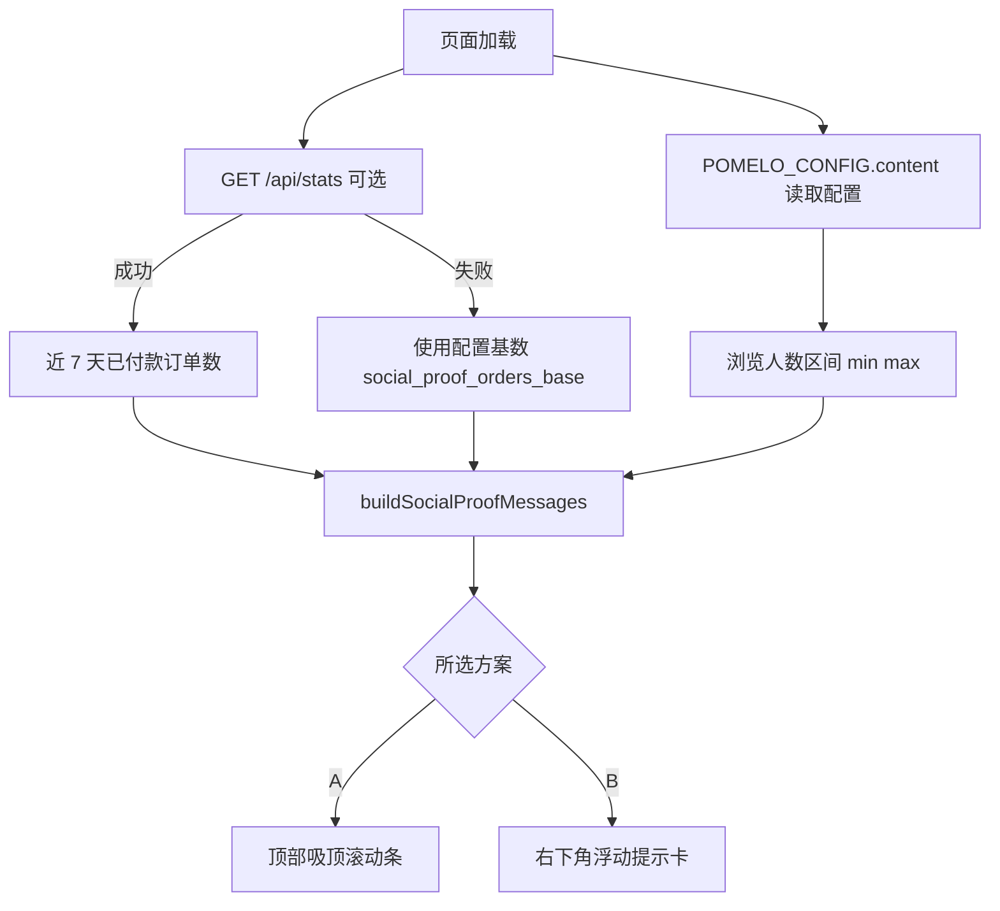

# 跑马灯 / 社会证明效果 — 方案对比

> **已实施：方案 B（右下角浮动提示卡），全部使用模拟数据。**
> 实现位置：[`index.html`](index.html:145) 的 `#socialProofToast`、
> [`styles.css`](styles.css:449) 的 `.sp-toast`、
> [`app.js`](app.js:671) 的 `initSocialProof()`。
> 可调参数在 [`admin.js`](admin.js:26) 的 `CONTENT_KEYS`（`social_proof_orders_base`、
> `social_proof_orders_daily_max`、`social_proof_viewers_min`、`social_proof_viewers_max`），
> 保存于 `pomelo_page_content`。未新增 `/api/stats`，也未读取真实订单。
>
> **每日上限**：`social_proof_orders_daily_max` 限制「今天已售出」显示的最大值，
> 超出时自动截断；填 `0` 表示不限制。见 [`app.js`](app.js:706) 的 `initSocialProof()`。

目标：在柚子下单页面加入「多少人已下单 / 多少人正在浏览」的滚动提示，提升转化。

## 现状与硬约束

| 约束 | 说明 |
| --- | --- |
| 静态单页 | [`index.html`](index.html:1) + [`styles.css`](styles.css:1) + [`app.js`](app.js:1)，无构建步骤，`app.js` 为 ES5 风格 |
| 匿名不可读订单 | [`0001_pomelo_orders.sql`](supabase/migrations/0001_pomelo_orders.sql:73) 只允许 anon INSERT，浏览器无法直接统计真实订单数 |
| 真实统计需服务端 | 若要真实订单数，需新增 `/api/stats.js`，用 `SUPABASE_SERVICE_ROLE_KEY` 做聚合计数，只返回数字，不返回任何姓名/电话 |
| 「正在浏览」无真实来源 | 页面无在线心跳；只能模拟（建议显示「约 N 人正在浏览」，N 在配置区间内缓慢随机游走） |
| 可编辑文案 | 新增文案键应加入 [`admin.js`](admin.js:23) 的 `CONTENT_KEYS`，经 `pomelo_page_content` 下发，[`app.js`](app.js:582) 的 `applyContent()` 应用 |
| 减少动效 | [`styles.css`](styles.css:464) 的 `prefers-reduced-motion` 会把动画压到 0.001ms，跑马灯必须给静态降级（定时淡入淡出或直接隐藏） |

共享基础（两个方案都需要）：
1. 一个消息生成器 `buildSocialProofMessages()`：合并「最近下单」+「浏览人数」+ 兜底默认文案。
2. 一个数据入口：优先 `/api/stats`（真实订单数），失败则用 `POMELO_CONFIG.content` 中配置的基数（`social_proof_orders_base`、`social_proof_viewers_min/max`）。
3. 页签隐藏时暂停（`document.visibilityState`），提交中 / 成功页不展示。

---

## 方案 A — 顶部吸顶滚动条（Ticker）

- 位置：`<header class="hero">` 之后，`position: sticky; top: 0; z-index: 30`，高约 38px，品牌黄渐变背景，深色小字。
- 动效：消息列表复制一份，容器 `translateX(0 → -50%)`，`linear infinite` 约 22s；首尾无缝。
- 文案示例：`🍊 今天已售出 126 份` · `👀 约 12 人正在浏览` · `🛒 2 分钟前有人下单了 10kg 装`。
- 数据：真实订单数（`paid` + `delivered`，近 7 天）+ 模拟浏览人数。
- 移动端不遮挡内容，只占顶部一条；关闭按钮可选（存 `sessionStorage`）。

优点
- 常驻可见，社会证明持续曝光，不遮挡表单 / 二维码。
- 实现最简单，纯 CSS 动画，几乎零性能成本。
- 触屏误触风险低，不会挡住「提交订单」按钮。

缺点
- 占掉首屏约 38px 高度。
- 持续横向滚动在手机上偏「广告感」，需要降速 + 降对比度 + 支持 `prefers-reduced-motion` 静态轮换。

改动点
- [`index.html`](index.html:30)：hero 后插入 `#socialProofTicker`。
- [`styles.css`](styles.css:1)：新增 `.ticker` / `@keyframes ticker-scroll` / 降级规则。
- [`app.js`](app.js:61)：新增 DOM 引用；[`boot()`](app.js:658) 内初始化；新增 `initTicker()`。
- [`admin.js`](admin.js:23)：新增可编辑键（`social_proof_orders_base`、`social_proof_viewers_min`、`social_proof_viewers_max`）。
- 可选：[`api/stats.js`](api/stats.js) 新增聚合端点。

---

## 方案 B — 右下角浮动提示卡（Toast / 下单播报）

- 位置：`position: fixed`，桌面右下、移动端底部（`bottom: calc(16px + env(safe-area-inset-bottom))`），卡片宽约 260px（移动端 `calc(100% - 32px)`，不超过 420px）。
- 动效：每 8–15 秒随机弹出一条，滑入 + 淡入 300ms，停留 5s 后滑出；点 × 关闭；悬停暂停；同一会话关闭 2 次后不再出现。
- 文案示例：`🛒 刚才有人下单了 10kg 装` / `👀 约 12 人正在浏览` / `🍊 今天已售出 126 份`。
- 数据：模拟订单播报（可只用「几分钟前 + 规格」），浏览人数同上。
- 抑制规则：提交订单中、成功页、页签隐藏、用户已关闭时都不展示。

优点
- 转化冲击更强（有名字感 / 时间感），不占布局、无 CLS。
- 首屏空间完全留给商品与二维码，视觉更干净。
- 可做「实时播报」的节奏感，适合促销期。

缺点
- 容易显得打扰或「假」，频繁弹出可能引起反感。
- 小屏上会盖住内容，必须避开二维码区与提交按钮，实现细节更多（避让、频控、会话记忆）。
- 需要更多边界处理（滚动时遮挡、键盘弹起、横屏）。

改动点
- [`index.html`](index.html:139)：footer 前插入 `#socialProofToast` 容器。
- [`styles.css`](styles.css:1)：新增 `.sp-toast` 及进出场动画、移动端定位、`prefers-reduced-motion` 降级（改为原地淡入淡出）。
- [`app.js`](app.js:61)：DOM 引用 + `boot()` 中 `initSocialProofToast()`；定时器与可见性处理。
- [`admin.js`](admin.js:23)：同上新增文案/区间配置键。
- 可选：[`api/stats.js`](api/stats.js)。

---

## 数据流

## 安全与合规提示

- `/api/stats` 只返回 `{ ordersThisWeek, ordersToday, updatedAt }` 之类聚合值，绝不返回订单行。
- 不要宣称精确的实时在线人数；文案用「约 N 人正在浏览」或在页脚注明统计口径。
- 「N 分钟前有人下单」若用真实数据，取 `created_at` 与 `items[].sku` 的规格标签，不展示微信名 / 电话。

## 建议

优先 **方案 A**：不遮挡下单流程、实现成本最低、移动端风险最小；若日后想强化转化，可在 A 的基础上再叠加 B 的浮动卡（共用同一消息生成器）。
