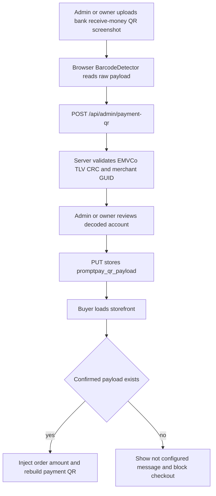

# Plan — Remove redundant 敏感设置 and make 收款二维码 the single payment source

> **Update:** the payment QR is now manageable by `admin` as well as `owner`.
> The original plan restricted confirm/clear to the owner; see
> [`0008_pomelo_settings_admin_write.sql`](../supabase/migrations/0008_pomelo_settings_admin_write.sql).
> Any "owner only" wording below is superseded.

## 1. Audit conclusion

The reported overlap is confirmed:

1. `bank_name`, `bank_account`, and `bank_holder` are stored by [`api/admin/settings.js`](../api/admin/settings.js:17) and rendered by [`admin.js`](../admin.js:33), but no buyer-facing or order-facing code ever reads them.
2. `promptpay_id` duplicates the receiving account already encoded in `promptpay_qr_payload`:
   - [`api/config.js`](../api/config.js:108) gives the confirmed payload precedence.
   - [`app.js`](../app.js:335) builds the buyer QR from the payload when it exists.
   - [`api/admin/payment-qr.js`](../api/admin/payment-qr.js:176) already decodes the PromptPay ID from the uploaded QR.
3. The duplication causes a display bug: [`app.js`](../app.js:903) shows `promptPayId` even when the active QR uses a different confirmed payload.

Target state:

- The `敏感设置` tab, its API endpoint, `promptpay_id`, and all bank fields are removed.
- `promptpay_qr_payload` is the only payment configuration.
- If no confirmed payload exists, the storefront clearly reports that payment is unavailable and blocks checkout.
- Admins and owners can decode, confirm, and clear the QR; role `user` cannot.

## 2. Target flow



## 3. Implementation steps

### Step 1 — Remove the settings backend

- Delete [`api/admin/settings.js`](../api/admin/settings.js:1).
- Add a `GET` handler to [`api/admin/payment-qr.js`](../api/admin/payment-qr.js:41):
  - Require role `admin`.
  - Read `pomelo_settings` for key `promptpay_qr_payload`.
  - Return `{ payload: string, decoded: object | null }`.
  - Decode the payload with the existing `decodePayload()` helper when present; return `decoded: null` on malformed legacy data instead of throwing a 500.
- Update the endpoint header comment to document `GET`, `POST`, `PUT`, and `DELETE`.

### Step 2 — Remove `promptpay_id` from `/api/config`

File: [`api/config.js`](../api/config.js:1)

- Remove `promptPayId` from the config object and the header comment.
- Remove `process.env.PROMPTPAY_ID`.
- Remove the `promptpay_id` branch in the settings loop.
- Keep `promptPayQrPayload` as the only payment value read from `pomelo_settings`.
- Remove `PROMPTPAY_ID` from the `missing` check. A missing QR is now a storefront state, not an environment-variable error.
- Update comments to state that an empty `promptPayQrPayload` means payment is not configured.

### Step 3 — Remove the storefront fallback path

File: [`app.js`](../app.js:254)

- Delete the legacy `promptPayId` branch in `renderQr()`.
- Always use `applyAmountToPayload(state.config.promptPayQrPayload, amountBaht)` when a payload exists.
- When no payload exists:
  - Set `state.paymentReady = false`.
  - Render a clear message such as `卖家尚未配置收款二维码，请联系卖家` inside the QR frame.
  - Clear `state.lastQrPayload`.
- When a payload exists and the QR is generated successfully, set `state.paymentReady = true`.
- If `applyAmountToPayload()` throws, set `state.paymentReady = false` and show the existing invalid-payment message.
- Update [`updateSubmitState()`](../app.js:244) to require `state.paymentReady` in addition to the existing checks, so checkout cannot proceed without a payment QR.
- Initialize `paymentReady: false` in the app state.
- Fix the label logic in [`applyConfig()`](../app.js:894):
  - Remove the `cfg.promptPayId` branch.
  - Show `PromptPay · 已确认收款账户` only when `cfg.promptPayQrPayload` exists.
  - Clear the payment label when it does not.
- Update [`refreshPaymentSettings()`](../app.js:976):
  - Select only `promptpay_qr_payload` from `pomelo_settings`.
  - When the row is absent, explicitly clear `next.promptPayQrPayload` instead of leaving a stale value.
  - Re-run `updateSubmitState()` after refreshing.
- Remove the `promptpay_id` comment and references in the boot section.

### Step 4 — Remove the unused PromptPay payload builder

- Remove `<script src="/promptpay.js"></script>` from [`index.html`](../index.html:172).
- Delete [`promptpay.js`](../promptpay.js:1) because the storefront no longer builds a payload from a raw ID.
- Do not remove the CRC/TLV logic in [`app.js`](../app.js:267): it is still needed to inject the order amount into the confirmed payload.
- Do not remove the server-side EMVCo parser in [`api/admin/payment-qr.js`](../api/admin/payment-qr.js:53): it is still the validation authority.

### Step 5 — Remove the settings UI

File: [`admin.html`](../admin.html:171)

- Remove the `settings` tab button.
- Remove the entire `panel-settings` section.
- Update the `收款二维码` description:
  - State that this is the only payment configuration.
  - State that buyers cannot pay until a QR is confirmed.
  - State that the owner confirms the decoded account before it becomes active.

File: [`admin.js`](../admin.js:1)

- Delete the `SETTING_KEYS` constant.
- Keep `state.settings` only as the container for the confirmed payload.
- Remove `loadSettings()`, `renderSettings()`, and `onSettingsSave()`.
- Remove the `settings` branch from [`activateTab()`](../admin.js:215).
- Remove `settingsSave`, `settingsNote`, and `settingsBody` handling from [`applyRoleGating()`](../admin.js:182).
- Remove the corresponding cache entries in [`cacheElements()`](../admin.js:1384).
- Remove the `settingsSave` click listener in [`wireEvents()`](../admin.js:1457).
- Change [`loadPaymentQr()`](../admin.js:892) to call `GET /api/admin/payment-qr` and populate `state.settings.promptpay_qr_payload`.
- Update the empty-state message in [`renderCurrentPaymentQr()`](../admin.js:913) to remove the reference to `敏感设置` and state that payment is unavailable until a QR is confirmed.
- Keep the existing role rules:
  - `admin` may load and decode.
  - `owner` may confirm, clear, and change the active payload.

### Step 6 — Database migration 0007

Create `supabase/migrations/0007_pomelo_payment_qr_only.sql`.

Contents:

1. Delete legacy settings rows:
   ```sql
   delete from public.pomelo_settings
   where key in ('promptpay_id', 'bank_name', 'bank_account', 'bank_holder');
   ```
2. Replace the anonymous read policy from migration `0005`:
   ```sql
   drop policy if exists "settings_anon_payment_read" on public.pomelo_settings;
   create policy "settings_anon_payment_read"
     on public.pomelo_settings for select
     to anon
     using (key = 'promptpay_qr_payload');
   ```
3. Update the table comment to say it now holds only the confirmed payment QR payload.
4. Add a verification query at the end that lists remaining keys.

Deployment sequencing is important for the existing live database:

- Deploy the code changes first.
- Sign in as owner and confirm a payment QR in the `收款二维码` tab.
- Verify that the storefront generates a correct QR.
- Then run migration `0007`.

Without this order, an existing shop that only had `promptpay_id` would lose its payment configuration. Fresh installations apply `0002` and then `0007`; the seed row from `0002` is deleted by `0007`, which is intentional.

### Step 7 — Update environment and documentation

- [`env.example`](../.env.example:26): remove the entire `PROMPTPAY_ID` block.
- [`README.md`](../README.md:38):
  - Add migration `0007` to the migration list.
  - Update the `pomelo_settings` description to “confirmed payment QR payload only”.
  - Remove `PROMPTPAY_ID` from the environment variable table.
  - Remove `PROMPTPAY_ID` from the local-development instructions.
  - Remove the `promptpay.js` vendoring note and the file-tree entry.
  - Document that a confirmed bank QR is now required before buyers can pay.
- [`plans/rbac-design.md`](../plans/rbac-design.md:15):
  - Replace references to “sensitive settings / PromptPay ID / bank info” with “confirmed payment QR”.
  - Update the permission matrix and endpoint table.
  - Mark the old settings endpoint as removed.
- [`plans/user-tier-permissions-audit.md`](../plans/user-tier-permissions-audit.md:145):
  - Annotate the `promptpay_id` and bank-field findings as resolved by removing those fields entirely.
- [`plans/BACKLOG.md`](../plans/BACKLOG.md:1):
  - Update `SEC-09` to note that the settings tab and endpoint were removed rather than retained.
  - Update `SEC-17` to resolved: `promptpay_qr_payload` can now only be written by `PUT /api/admin/payment-qr`.
  - Add a `FEAT` or `SEC` entry recording this consolidation.
  - Update the completion counts and `Last updated` date.

### Step 8 — Verification

Code and reference checks:

- Search the repository for `promptpay_id`, `promptPayId`, `PROMPTPAY_ID`, `bank_name`, `bank_account`, `bank_holder`, `/api/admin/settings`, and `promptpay.js`.
- Expect zero live references outside historical plan documents and migration comments.

Admin console checks:

- The tab bar no longer shows `敏感设置`.
- `/admin.html` loads without JavaScript errors.
- `admin` can open `收款二维码`, upload and decode an image, but cannot confirm or clear.
- `owner` can confirm a QR, reload the page, and still see the confirmed payload and preview.
- `owner` can clear the QR; the panel immediately shows the “not configured” message.

Storefront checks:

- With no confirmed payload:
  - The QR area shows the not-configured message.
  - The submit button remains disabled even after filling the form and selecting a slip.
- With a confirmed payload:
  - Selecting a product generates a QR containing the correct amount.
  - Changing quantity regenerates the QR with a recomputed CRC.
  - The displayed payment label no longer shows a stale PromptPay ID.
- Refresh the page after changing the QR in admin and confirm the storefront picks up the new payload from Supabase.

API checks:

- `GET /api/admin/payment-qr` without a token returns 401/403.
- `GET /api/admin/payment-qr` as `admin` and `owner` returns the current payload.
- `POST /api/admin/payment-qr` as `admin` decodes but does not persist.
- `PUT` and `DELETE /api/admin/payment-qr` as `admin` return 403.
- `PUT` and `DELETE /api/admin/payment-qr` as `owner` succeed.
- `/api/admin/settings` returns 404 after deletion.
- `/api/config` no longer contains `promptPayId`.

Database checks:

- `anon` can select only `promptpay_qr_payload` from `pomelo_settings`.
- `anon` cannot select `promptpay_id`, `bank_name`, `bank_account`, or `bank_holder` because those rows and the policy branch are gone.
- Staff can still read the confirmed payload through the admin endpoint.

### Step 9 — Rollback note

If a rollback is needed after migration `0007`:

- Redeploy the previous code version.
- Restore the removed environment variable `PROMPTPAY_ID`.
- Reinsert `promptpay_id` if the previous code relies on the database value:
  ```sql
  insert into public.pomelo_settings (key, value)
  values ('promptpay_id', 'REAL_PROMPTPAY_ID')
  on conflict (key) do update set value = excluded.value;
  ```
- Restore the `0005` anonymous policy if the old storefront must read `promptpay_id`.

The confirmed `promptpay_qr_payload` row is never deleted by migration `0007`, so a rollback to the QR-based flow remains safe.
