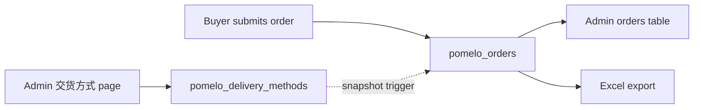

# Plan — Show the exact pickup point in the admin console and Excel

## 1. Problem

When a buyer chooses 自提, the order record keeps no explicit pickup-point information.
The admin order list and the Excel export only print the delivery-method label, so staff
packing/delivering cannot tell which of the three pickup points the customer selected.

**Scope decision:** the buyer-facing storefront is **unchanged**. Only the database, the
admin console and the Excel export are modified.

## 2. Root cause

| Layer | Current behaviour | Consequence |
| --- | --- | --- |
| `pomelo_delivery_methods` | Only `label`, `description`, `map_url`, `time_window` exist | No explicit "自提点名称 / 地址" field |
| Order insert [`app.js`](../app.js:634) | Stores only `fulfilment` (the code) | Admin/export must resolve the code and cannot show point text |
| Admin order table [`fulfilmentLabel()`](../admin.js:258) | Renders `label` only | Three different points can all read `自提` |
| Excel export [`buildColumns()`](../api/admin/orders-export.js:101) | `交货方式` = `labels[fulfilment]` only | Same ambiguity in the spreadsheet |
| Method rename/delete | Nothing snapshotted | Historical orders lose the original point name |
| Storefront [`app.js`](../app.js:529) / [`index.html`](../index.html:148) | Out of scope | No changes in this task |

The three live pickup points are **rows in `pomelo_delivery_methods`** created from the
admin console; they are not seeded in the repo, so the first implementation step is to
inspect them.

## 3. Target model

One row in `pomelo_delivery_methods` = one pickup point. Each order stores a **snapshot**
of the method at submit time, so history survives renames, deactivations and deletes.



## 4. Discovery (do this first)

Run in the Supabase SQL editor **before writing the migration** and keep the output; it
tells you which existing row maps to which physical point:

```sql
-- The three live pickup points and their current labels/details
-- (pickup_point / pickup_address do not exist yet — added by 0009)
select code, label, description, time_window, map_url, sort_order, active
from public.pomelo_delivery_methods
order by sort_order, code;

-- How many historical orders exist per method
select fulfilment, count(*) as orders
from public.pomelo_orders
group by fulfilment
order by orders desc;
```

If the three rows currently share a generic label (`自提`) or use `description` for the
branch name, record the intended `自提点名称` and `详细地址` for each code — an admin will
enter them in the console after deployment.

## 5. Database — new migration `0009_pomelo_pickup_points.sql`

Additive only; safe to run before the code deploy.

### 5.1 Pickup fields on delivery methods

```sql
alter table public.pomelo_delivery_methods
  add column if not exists pickup_point   text not null default '',
  add column if not exists pickup_address text not null default '';

comment on column public.pomelo_delivery_methods.pickup_point is
  'Short pickup-point name used in the admin console and Excel export (e.g. 拉差达店).';
comment on column public.pomelo_delivery_methods.pickup_address is
  'Full pickup address / landmark. Used by staff and the Excel export.';
```

Existing rows keep `pickup_point = ''`. Display code falls back to `label`, so nothing
changes until an admin fills the real point name. This avoids duplicating the label.

### 5.2 Snapshot columns on orders

```sql
alter table public.pomelo_orders
  add column if not exists fulfilment_label   text,
  add column if not exists pickup_point       text,
  add column if not exists pickup_address     text,
  add column if not exists pickup_time_window text,
  add column if not exists pickup_map_url     text;
```

### 5.3 Server-side snapshot trigger

A `before insert or update of fulfilment` trigger fills the snapshot from the canonical
table. This is deliberately **not** done in the browser: buyers insert orders with the
anon key, so the snapshot must not be client-controlled.

```sql
create or replace function public.pomelo_snapshot_fulfilment()
returns trigger
language plpgsql
security definer
set search_path = public, pg_temp
as $$
declare
  m public.pomelo_delivery_methods%rowtype;
begin
  select * into m
  from public.pomelo_delivery_methods
  where code = new.fulfilment;

  if found then
    new.fulfilment_label   := m.label;
    new.pickup_point       := coalesce(m.pickup_point, '');
    new.pickup_address     := coalesce(m.pickup_address, '');
    new.pickup_time_window := coalesce(m.time_window, '');
    new.pickup_map_url     := coalesce(m.map_url, '');
  else
    new.fulfilment_label := case new.fulfilment
      when 'self_pickup' then '自提'
      when 'grab_cod'    then 'Grab 到付'
      else new.fulfilment
    end;
    new.pickup_point := coalesce(new.pickup_point, '');
    new.pickup_address := coalesce(new.pickup_address, '');
  end if;

  return new;
end;
$$;

drop trigger if exists pomelo_orders_snapshot_fulfilment on public.pomelo_orders;
create trigger pomelo_orders_snapshot_fulfilment
  before insert or update of fulfilment on public.pomelo_orders
  for each row execute function public.pomelo_snapshot_fulfilment();
```

Notes:
- `security definer` keeps the lookup working regardless of the caller's RLS path, and
  the function has no dynamic SQL.
- Because the trigger fires on `update of fulfilment`, an admin changing the method on an
  order re-snapshots automatically. The snapshot columns are **not** added to
  `ADMIN_EDITABLE` in [`api/admin/orders.js`](../api/admin/orders.js:22).

### 5.4 Backfill historical orders

```sql
update public.pomelo_orders o
set fulfilment_label = coalesce(
      (select m.label from public.pomelo_delivery_methods m where m.code = o.fulfilment),
      case o.fulfilment
        when 'self_pickup' then '自提'
        when 'grab_cod'    then 'Grab 到付'
        else o.fulfilment
      end),
    pickup_point = coalesce(
      (select m.pickup_point from public.pomelo_delivery_methods m where m.code = o.fulfilment), ''),
    pickup_address = coalesce(
      (select m.pickup_address from public.pomelo_delivery_methods m where m.code = o.fulfilment), ''),
    pickup_time_window = coalesce(
      (select m.time_window from public.pomelo_delivery_methods m where m.code = o.fulfilment), ''),
    pickup_map_url = coalesce(
      (select m.map_url from public.pomelo_delivery_methods m where m.code = o.fulfilment), '')
where o.fulfilment_label is null;
```

Verification queries at the end of the migration:

```sql
select fulfilment, count(*) as orders,
       count(*) filter (where pickup_point is not null and pickup_point <> '') as with_point
from public.pomelo_orders
group by fulfilment
order by orders desc;
```

## 6. API changes

### 6.1 [`api/config.js`](../api/config.js:78)

**No change.** The storefront keeps using `label` / `description` / `map_url` /
`time_window`; the new admin-only fields are not exposed publicly.

### 6.2 [`api/admin/delivery-methods.js`](../api/admin/delivery-methods.js:24)

- Add `MAX_PICKUP_POINT = 80` and `MAX_PICKUP_ADDRESS = 240`.
- Extend `normalise()` to trim/validate `pickup_point` and `pickup_address`
  (same pattern as `description`).
- Update the header comment so the field list matches the table.

### 6.3 [`api/admin/orders.js`](../api/admin/orders.js:22)

No payload change needed — `select("*")` returns the snapshot columns. Do **not** add the
snapshot fields to `ADMIN_EDITABLE`.

### 6.4 [`api/admin/orders-export.js`](../api/admin/orders-export.js:69)

- Load the full method map, not just labels:
  `select code, label, pickup_point, pickup_address, time_window`.
- Resolve each field snapshot-first, falling back to the live method row for orders
  created before migration 0009:

```js
const live = methodsByCode[o.fulfilment] || {};
const label   = o.fulfilment_label   || live.label || labels[o.fulfilment] || o.fulfilment || "";
const point   = o.pickup_point       || live.pickup_point || label;
const address = o.pickup_address     || live.pickup_address || "";
const window  = o.pickup_time_window || live.time_window || "";
```

- `交货方式` uses `label`.
- Add columns after `交货方式`:
  - `自提点` → `point`
  - `自提地址` → `address`
  - `取货时间` → `window`

## 7. Storefront — no changes

[`app.js`](../app.js:529), [`index.html`](../index.html:148) and
[`styles.css`](../styles.css:302) are deliberately untouched. The buyer still selects one
交货方式 option (one row = one pickup point); the order keeps the `fulfilment` code and
the trigger snapshots the backend fields.

> Confirmed: buyers can already select exactly one of the pickup points as a 交货方式
> option. The order therefore carries the correct `fulfilment` code; only the backend
> needs to resolve and display it.

## 8. Admin console

### 8.1 [`admin.html`](../admin.html:246)

Add two inputs to the 交货方式 form:

- `dmPickupPoint` — 自提点名称, placeholder `拉差达店`
- `dmPickupAddress` — 详细地址, placeholder `XXX 路 123 号 …`

Update the section hint to explain that each row is one pickup point.

### 8.2 [`admin.js`](../admin.js:1338)

- Register the two new DOM refs.
- Include them in `onDeliveryEdit()`, `onDeliverySave()` and `resetDeliveryForm()`.
- Add `自提点` and `地址` columns to the delivery-methods table
  ([`renderDeliveryMethods()`](../admin.js:614)); keep the table readable by combining
  `名称` + `副标题` in one cell if needed.
- Add `orderFulfilmentCell(o)` for the orders table
  ([`renderOrders()`](../admin.js:267)):
  - line 1: `o.fulfilment_label || fulfilmentLabel(o.fulfilment)`
  - line 2 (`muted`): point name — `o.pickup_point || live.pickup_point || label`
  - line 3 (`muted`): `o.pickup_address || live.pickup_address`
  - line 4 (optional): a `地图` link built from `o.pickup_map_url || live.map_url`,
    rendered only when `safeHttpUrl()` accepts it.
  - Fall back to the live method row when the snapshot is missing (pre-0009 orders).

## 9. Operational data entry

After the migration and deploy, an admin/owner opens **交货方式** and fills
`自提点名称` + `详细地址` for the three existing rows (and keeps `取货时间` / `Google Maps`
up to date). Until this is done, the admin table and Excel fall back to the delivery
method label, so nothing breaks — but the real point name is only visible once entered.
No storefront redeploy is needed.

## 10. Edge cases and consistency rules

- **Rename** a pickup point → old orders keep the snapshot; new orders use the new value.
- **Deactivate** a point → still displayed and exported on old orders.
- **Delete** a point → old orders keep the snapshot; new orders can no longer select it.
- **Change `fulfilment` on an order** (admin/owner) → trigger re-snapshots.
- **Buyer spoofing** → snapshot fields are overwritten by the trigger, never trusted.
- **Legacy orders** → migration backfill + read-time fallback to the live method row.
- **Migrate before deploy** → the admin/export code reads the new columns; run 0009 first.

## 11. Verification checklist

1. Migration verification queries return no rows with `fulfilment_label is null`.
2. Confirm the live storefront exposes three distinct 交货方式 options (scope assumption).
3. Submit a test order for each point, then check the admin orders table shows
   `自提` + point name + address for that row.
4. Excel export (inline and download) contains `交货方式`, `自提点`, `自提地址`,
   `取货时间` with the correct values.
5. Historical orders show backfilled values after 0009.
6. Rename one point, then reload: old order unchanged, new order shows the new name.
7. Deactivate one point: it stays visible/exported on old orders.

## 12. Execution todo

1. Run the discovery SQL and record the three method codes + intended point/address text.
2. Write `supabase/migrations/0009_pomelo_pickup_points.sql` (columns, trigger, backfill,
   verification).
3. Update `api/admin/delivery-methods.js` validation for the new fields.
4. Update `api/admin/orders-export.js` with the method map and three new columns.
5. Update `admin.html` / `admin.js` delivery-method form and table.
6. Update `admin.js` order table to show the snapshotted point.
7. Run the migration, deploy, then fill the three pickup points in the admin console.
8. Run the verification checklist and tick `FEAT-06` in `plans/BACKLOG.md`.
