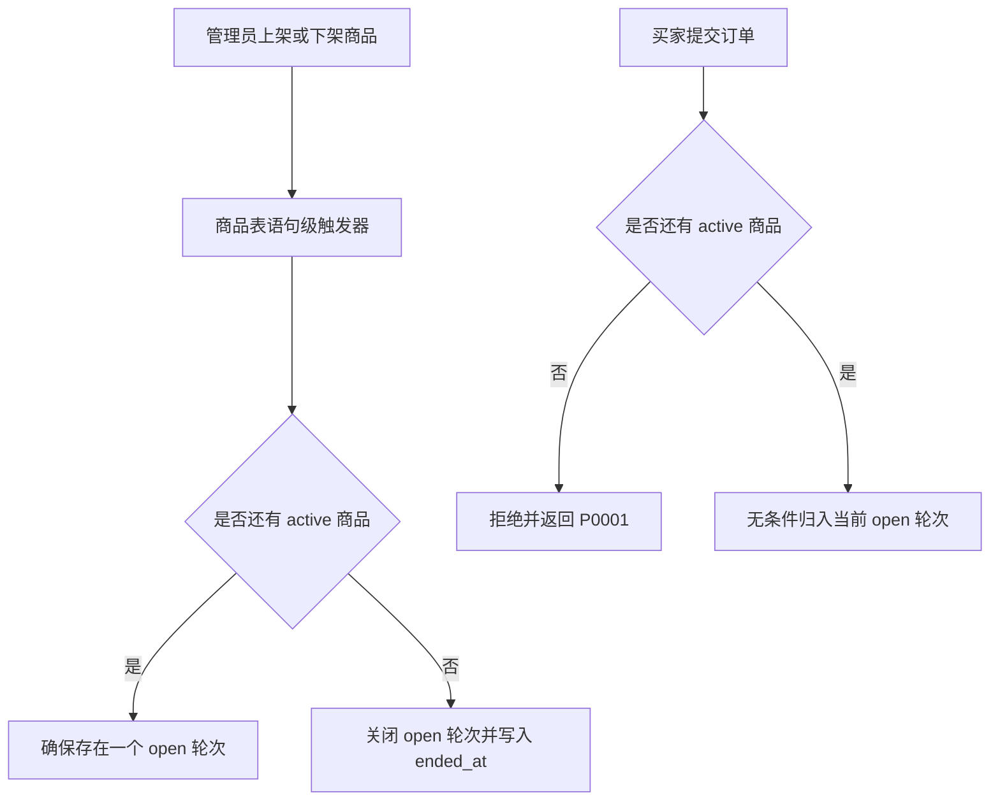
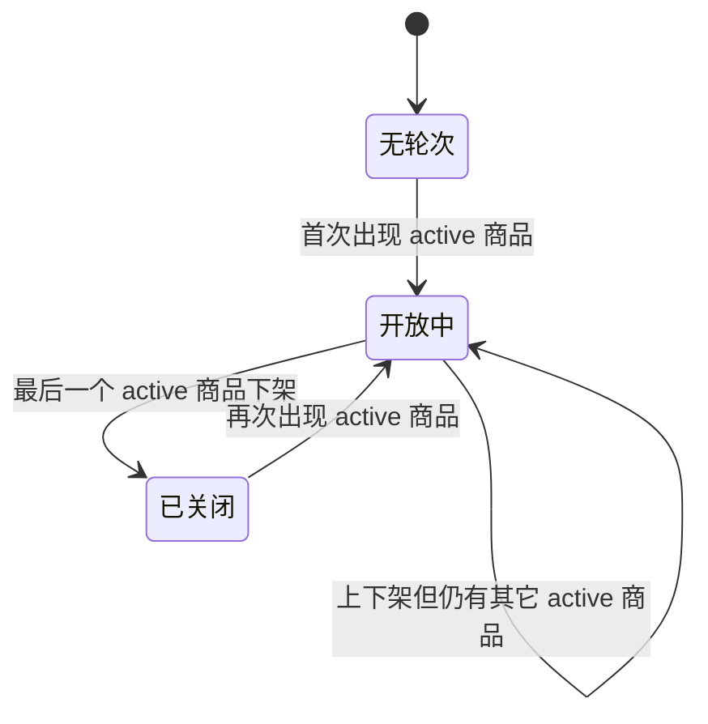

# Pomelo Shop — 销售轮次（Sales Round）最小化设计

> **本文档取代此前的复杂方案。** 旧方案中的 Rotate / Open / Close RPC、导出日志表、`NOT NULL` 强回填、
> `api/config.js` 改造、匿名读策略变更、轮次管理权限体系**全部取消**。
> 新方案的出发点是：**轮次的开关完全由「商品是否还有在售」推导，人不需要操作任何东西。**

状态：设计**已定稿**（四项最终决定见 §14）。本阶段只修改了本文档，**未修改任何业务代码，未创建或执行 Migration，未部署**。等待批准进入实施。

> **并发口径（定稿）**：不引入 advisory lock、不引入任何额外并发控制层、不引入前端轮次会话标记、
> 不引入订单归属补偿 / 重试 / 回填。只使用普通的数据库事务（触发器与触发它的语句同事务）和一条部分唯一索引。
> 极少数并发边界情况按「可接受」处理，不为其设计专门的恢复系统（见 §4.3、§13）。

---

## 0. 结论摘要

| 问题 | 结论 |
| --- | --- |
| 轮次由谁触发 | **数据库**。商品表的语句级触发器在每次商品变更后重算「是否还有在售商品」，据此开关轮次 |
| 需要管理员操作吗 | **不需要**。没有 Rotate / Open / Close 按钮，也没有轮次编号输入 |
| 订单归属由谁保证 | `pomelo_orders` 的 `BEFORE INSERT` 触发器，客户端传什么都无效 |
| 并发控制 | **无额外并发控制层**。只用普通事务 + 一条部分唯一索引；不加锁、不加队列、不加补偿（§4.3） |
| 数据库新增 | 1 张表（4 列）+ 1 个可空列（`sales_round_id`）+ 1 个索引 + 1 个唯一约束 + 5 个触发器（3 个在商品表、2 个在订单表） |
| 业务代码改动 | 后台订单列表加一个筛选下拉；Excel 导出加一个查询参数并修掉一个**已存在的**截断 bug |
| 前台 `app.js` / `api/config.js` | **零改动**（已验证理由见 §8） |
| 现有 RLS | **零改动**，不放宽任何一条 |
| 存量订单 | **无法还原**（证据见 §7），保留为 `sales_round_id = null` 的「未归档」，可查看可导出 |



---

## 1. 现有代码事实核对（带文件行号）

### 1.1 商品数据存在哪里、上架状态用哪个字段

`public.pomelo_catalogue`，定义在 [`0002_pomelo_rbac.sql:209`](../supabase/migrations/0002_pomelo_rbac.sql:209)：

| 列 | 类型 | 说明 |
| --- | --- | --- |
| `sku` | `text primary key` | 规范码 `POM-<SIZE>-<NNN>`，由 API 生成、不可改（[`0003:70`](../supabase/migrations/0003_pomelo_sku_codes.sql:70) 加了 CHECK） |
| `label` | `text not null` | 展示名 |
| `unit_price` | `integer not null check >= 0` | 泰铢整数 |
| `sort_order` | `integer not null default 0` | 排序 |
| `active` | `boolean not null default true` | **唯一的上架/下架状态字段** |

核对结论：**只有一个布尔列 `active`**，没有 `status`、没有 `published`、没有软删除时间戳，也没有 `created_at` / `updated_at`。
⚠️ 该表**完全没有时间戳列**，这一点直接决定了 §7 的存量订单结论。

### 1.2 上架/下架走哪些 API、函数、界面

| 操作 | 入口 | 服务端落点 |
| --- | --- | --- |
| 单商品上下架 | [`admin.js:530 onCatalogueToggle()`](../admin.js:530) → `PATCH /api/admin/catalogue { sku, active }` | [`api/admin/catalogue.js:150 updateItem()`](../api/admin/catalogue.js:150) → `service_role` 执行 `update(patch).eq("sku", sku)` |
| 新建商品 | [`admin.js:584 onCatalogueSave()`](../admin.js:584) → `POST /api/admin/catalogue` | [`api/admin/catalogue.js:124 createItem()`](../api/admin/catalogue.js:124)，`active` 走默认值 `true` |
| 编辑商品 | 同上 `PATCH` | 只改 `label` / `unit_price` / `sort_order` / `active`（[`normalise()`](../api/admin/catalogue.js:75)） |
| 删除商品 | [`admin.js:571 onCatalogueDelete()`](../admin.js:571) → `DELETE /api/admin/catalogue` | [`api/admin/catalogue.js:174 deleteItem()`](../api/admin/catalogue.js:174)，**物理删除** |

### 1.3 是否存在批量修改多个商品状态的功能

**不存在。** 三个写接口都是单条（按 `sku` 定位）。但 §1.5 说明批量修改在数据库层面仍然可能发生，两者都必须覆盖。

### 1.4 状态修改是否经过统一的服务端入口

**没有统一入口，且不能假设有。** 共有三条互不相交的写入路径：

1. `/api/admin/catalogue`（`service_role`，见上表）；
2. **直接 PostgREST**：`catalogue_staff_write` 策略对 `authenticated` 开放（[`0002:228`](../supabase/migrations/0002_pomelo_rbac.sql:228)，`using / with check = public.is_admin_or_owner()`）。
   也就是说 admin / owner 拿着自己的 JWT，在浏览器控制台或任何 supabase-js 客户端里都能直接 `update pomelo_catalogue`，**完全绕过 `/api/admin/catalogue`**；
3. **SQL Editor / Dashboard / `psql`**，以 `postgres` 身份执行任意 `update`，包括一次改多行的批量语句。

### 1.5 结论：检测逻辑必须放在数据库，不能放在 API

这是本设计最重要的判断。若把「重算轮次」写在 [`api/admin/catalogue.js`](../api/admin/catalogue.js:150) 里：

- 路径 2、3 会被完全漏掉 → 管理员用 SQL 批量下架后轮次不关闭，且下次上架不会开新轮；
- 更糟的是**静默错误**：界面上一切正常，只有导出时才发现轮次错了，而这是事后无法修复的。

放在数据库触发器里，三条路径 100% 覆盖，且不需要任何写接口配合。

### 1.6 新订单 INSERT 的现有逻辑、订单与商品的关联方式

[`app.js:576 submitOrder()`](../app.js:576)，顺序是 **先上传水单 → 再 insert 订单**：

| 步骤 | 行号 | 说明 |
| --- | --- | --- |
| 上传水单 | [`app.js:609`](../app.js:609) | 路径 `<orderId>/slip.<ext>` |
| 取公开 URL | [`app.js:620`](../app.js:620) | |
| insert 订单 | [`app.js:634`](../app.js:634) | **用 anon key 直连 PostgREST**，显式带 `id`，**故意不加 `.select()`**（anon 无 SELECT 策略） |

- 订单**不引用**商品表：`items jsonb` 是下单时的快照 `[{sku, qty, unit_price, subtotal}]`，没有外键、没有商品 id。所以「订单 ↔ 商品」之间没有可用的历史关联信息可供回溯。
- `pomelo_orders` 的 anon INSERT 策略是 `with check (true)`（[`0001:73`](../supabase/migrations/0001_pomelo_orders.sql:73)）→ **该列不能靠 RLS 约束**，只能靠触发器。
- 从 0005 起 `authenticated` 已被 `revoke update`（[`0005:278`](../supabase/migrations/0005_pomelo_security_hardening.sql:278)），订单的写操作只经由 `/api/admin/orders`（`service_role`）。

### 1.7 当前 Excel 导出与后台列表筛选逻辑

| | 后台列表 | Excel 导出 |
| --- | --- | --- |
| 入口 | [`admin.js:231 loadOrders()`](../admin.js:231) | [`admin.js:366 exportOrders()`](../admin.js:366) |
| 接口 | `GET /api/admin/orders` | `GET /api/admin/orders-export` |
| 筛选 | 只有 `status`（[`admin.html:203 orderStatusFilter`](../admin.html:203)） | 只有 `status` |
| 查询 | [`orders.js:37`](../api/admin/orders.js:37) `select("*").order(created_at desc).limit(min(limit,500))` | [`orders-export.js:51`](../api/admin/orders-export.js:51) `select("*").order(created_at desc).limit(min(limit,20000))` |
| 生成 | 前端渲染表格 | [`buildWorkbook()`](../api/admin/orders-export.js:172) 手写 SpreadsheetML + ZIP，13 列，单 sheet，表头在第 1 行 |

**⚠️ 顺带发现一个既有 bug（必须一起修）**：Supabase 的 PostgREST 有服务端 `db-max-rows`（默认 **1000**），
`.limit(5000)` / `.limit(20000)` **无法突破它**，超出部分被静默丢弃。也就是说**现在导出超过 1000 单就会少数据且不报错**。
新要求是「每次导出包含该轮次全部订单」，所以导出必须改成 `.range()` 分页拉取（见 §9）。

---

## 2. 业务模型

一句话：**轮次 = 一段「至少有一个商品在售」的连续区间。**

| 整体商品状态 | 轮次行为 |
| --- | --- |
| 至少一个 `active = true` | 存在且仅存在一个 `status = 'open'` 的轮次 |
| 全部 `active = false` | 该轮次 `status = 'closed'`，写入 `ended_at` |
| 全部下架后又出现 `active = true` | 新建一个轮次，`started_at = now()` |
| 同一轮次内商品反复上下架（始终有商品在售） | **不产生新轮次** |
| 新订单 | 归入当前 `open` 轮次 |

### 2.1 边界情况逐条验证

| 情况 | 操作序列 | 触发器看到的状态 | 结果 |
| --- | --- | --- | --- |
| **A** 多个商品依次下架 | A↓，B↓，C 仍↑ | 两次都「仍有 active」 | 轮次不动 ✅ |
| **B** 最后一个商品下架 | C↓ | 「已无 active」 | `status='closed'`，`ended_at=now()` ✅ |
| **C** 重新上架 | A↑ | 「有 active，且无 open」 | 新建轮次 ✅ |
| **D** 同轮内反复上下架 | A↓、A↑（B 始终↑） | 每次「仍有 active」 | 始终同一个轮次 ✅ |
| **E** 批量上架（语句内多行） | 一条语句把 3 个商品置 `active=true` | **语句级触发器只触发一次** | 只建 1 个轮次 ✅ |
| **F** 订单提交 | 买家 insert | 「无 active」→ 拒绝；否则归入 open 轮次 ✅ |

情况 D 与 E 决定了触发器的粒度**必须是语句级（`FOR EACH STATEMENT`）而不是行级**：
行级触发器在一条批量语句里会执行 N 次，若语句中间出现「瞬时 0 在售」（例如一条 `update` 用 `case` 同时把 A 置 false、B 置 true），行级实现会误切两次轮次；语句级实现只在一个语句结束后看一次最终状态，天然正确。

### 2.2 状态机



---

## 3. 最小化数据库设计

### 3.1 新增表 `pomelo_sales_rounds`

只有 4 列。**没有** `round_number`（编号由查询时按 `started_at asc, id asc` 排序推导）、**没有** `created_by` / `closed_by`、**没有** `note`、**没有**导出日志。

```sql
create table if not exists public.pomelo_sales_rounds (
  id         uuid primary key default gen_random_uuid(),
  status     text        not null default 'open'
               check (status in ('open', 'closed')),
  started_at timestamptz not null default now(),
  ended_at   timestamptz
);

comment on table public.pomelo_sales_rounds is
  'Sales rounds. Open while at least one catalogue item is active; closed when all are inactive.';
comment on column public.pomelo_sales_rounds.status is
  'open = 当前接单轮次（最多一个）；closed = 已结束。由 pomelo_sync_sales_round() 维护。';

-- 硬保证：任何时候最多一个 open 轮次
create unique index if not exists pomelo_sales_rounds_one_open
  on public.pomelo_sales_rounds (status) where status = 'open';

-- 排序键：started_at 不保证唯一，加 id 作为第二排序条件，保证轮次编号稳定
create index if not exists pomelo_sales_rounds_started_idx
  on public.pomelo_sales_rounds (started_at desc, id desc);
```

`status` 与 `ended_at` 有一点冗余，唯一目的是让「最多一个 open」可以用部分唯一索引表达 —— 这是本方案**唯一**的并发约束（见 §4.3），代价是一列。

轮次编号：**不建 `round_number` 列**。编号在查询时按 `order by started_at asc, id asc` 推导（`id` 作为第二排序条件，防止两条记录 `started_at` 相同导致编号抖动）。

### 3.2 RLS

```sql
alter table public.pomelo_sales_rounds enable row level security;

-- 员工可读（沿用 is_staff()，与其它业务表一致）；anon 无任何策略；无写策略。
drop policy if exists "rounds_staff_read" on public.pomelo_sales_rounds;
create policy "rounds_staff_read"
  on public.pomelo_sales_rounds for select
  to authenticated
  using (public.is_staff());
```

- **anon：零策略** → 匿名者查不到任何轮次，也无法探测历史轮次数量。
- **无 INSERT / UPDATE / DELETE 策略** → 任何员工（含 admin / owner）都不能通过 PostgREST 手改轮次，只有触发器（`service_role` / `postgres`）能写。这正好满足「普通员工不能擅自切换销售轮次」，而且**不需要新建任何权限体系**。

### 3.3 订单表新增列

```sql
alter table public.pomelo_orders add column if not exists sales_round_id uuid;

create index if not exists pomelo_orders_round_created_idx
  on public.pomelo_orders (sales_round_id, created_at desc, id desc);

do $$
begin
  if not exists (
    select 1 from pg_constraint where conname = 'pomelo_orders_sales_round_fk'
  ) then
    alter table public.pomelo_orders
      add constraint pomelo_orders_sales_round_fk
      foreign key (sales_round_id)
      references public.pomelo_sales_rounds (id) on delete restrict;
  end if;
end $$;
```

关键点：

- **保持可空**（`null` = 未归档的历史订单，见 §7）。**不做** `set not null`，因此没有旧方案里那套「先回填再收口」的事务顺序约束。
- `add column` 无默认值 + 可空 ⇒ 不重写表、瞬时完成。
- FK 校验时存量行全是 `null` ⇒ 立即通过，无全表扫描。
- 索引列顺序 `(sales_round_id, created_at desc, id desc)`：`id` 作为唯一兜底，保证 `range()` 分页稳定（导出要求「不重不漏」）。
- `on delete restrict`：轮次一旦被订单引用就不能删，防止历史归属被抹掉。

### 3.4 为什么不建别的表

| 旧方案的组件 | 本期是否需要 | 原因 |
| --- | --- | --- |
| 导出日志表 | ❌ | 需求没有要求；导出是纯读 + 现算，每次都返回该轮次**当前的全部订单**，日志只会增加不一致风险 |
| 订单批次 / 仓库 / 打包状态 | ❌ | 与「销售轮次」无关 |
| 订单快照 | ❌ | `items jsonb` 已经是下单时的快照 |
| 轮次会话标记 / 归属补偿 | ❌ | 归属由数据库触发器一次性写定，没有「事后修正」的场景 |
| Cron 清理 | ❌ | 与轮次无关 |

---

## 4. 自动检测整体状态变化（放哪里、怎么写）

### 4.1 位置：`pomelo_catalogue` 的**语句级** `AFTER` 触发器

```sql
create or replace function public.pomelo_sync_sales_round()
returns trigger
language plpgsql
security definer
set search_path = public, pg_temp
as $$
declare
  v_has_active boolean;
  v_open_id    uuid;
begin
  select exists (select 1 from public.pomelo_catalogue where active) into v_has_active;
  select id into v_open_id from public.pomelo_sales_rounds
   where status = 'open' limit 1;

  if v_has_active and v_open_id is null then
    -- 0 → 有在售：开新一轮
    insert into public.pomelo_sales_rounds (status, started_at) values ('open', now());
  elsif not v_has_active and v_open_id is not null then
    -- 有在售 → 0：结束当前轮次
    update public.pomelo_sales_rounds
       set status = 'closed', ended_at = now()
     where id = v_open_id;
  end if;

  return null;   -- 语句级 AFTER 触发器的返回值被忽略
end;
$$;

drop trigger if exists pomelo_catalogue_round_sync_ins on public.pomelo_catalogue;
create trigger pomelo_catalogue_round_sync_ins
  after insert on public.pomelo_catalogue
  for each statement execute function public.pomelo_sync_sales_round();

drop trigger if exists pomelo_catalogue_round_sync_upd on public.pomelo_catalogue;
create trigger pomelo_catalogue_round_sync_upd
  after update on public.pomelo_catalogue
  for each statement execute function public.pomelo_sync_sales_round();

drop trigger if exists pomelo_catalogue_round_sync_del on public.pomelo_catalogue;
create trigger pomelo_catalogue_round_sync_del
  after delete on public.pomelo_catalogue
  for each statement execute function public.pomelo_sync_sales_round();
```

### 4.2 逐条核对

| # | 检查项 | 结论 |
| --- | --- | --- |
| 1 | 为什么是 `AFTER` 而不是 `BEFORE` | 需要看到**本条语句执行完之后**的整表状态；`BEFORE` 时行变更尚未生效 |
| 2 | 为什么是 `FOR EACH STATEMENT` | 情况 E（批量上架）与情况 D（同语句内瞬时归零）只有语句级才正确，见 §2.1 |
| 3 | 为什么不用 transition table（`REFERENCING OLD/NEW TABLE`） | 不需要。整表重算更简单，且天然覆盖 `insert` / `update` / `delete` 三种语句 |
| 4 | 为什么 `SECURITY DEFINER` + 固定 `search_path` | 触发器会被 `authenticated`（管理员经 PostgREST 直写，§1.4 路径 2）触发，而该角色对 `pomelo_sales_rounds` **没有任何写权限**。`DEFINER` 让函数以属主（`postgres`）身份写表；固定 `search_path` 防劫持。⚠️ 迁移必须由项目默认角色执行 |
| 5 | `EXECUTE` 权限要不要 revoke | **不要。** 与轮次切换函数相反：本函数在管理员 `INSERT/UPDATE/DELETE pomelo_catalogue` 时被隐式调用，若 `revoke ... from public` 又未 `grant` 给 `authenticated`，商品上下架会直接报 `permission denied for function`。函数无参数、返回 `trigger`，无法被直接调用，保留默认授权不构成攻击面 |
| 6 | 重复触发是否安全 | 安全。逻辑是「重算不变量 + 幂等写入」：状态正确时两个分支都不进入；`update` 只作用于 `status='open'` 的那一行 |
| 7 | 代价 | 每次商品变更做一次小表全扫描。商品表是个位数行、管理员手动操作，可忽略 |

### 4.3 并发口径：不做额外协调（定稿）

本方案**不引入任何并发控制层**，只依赖两样东西：

1. **普通数据库事务**：触发器与触发它的 `INSERT / UPDATE / DELETE` 处在同一个事务里，「重算状态 → 开关轮次」不会半途生效，别的会话也看不到中间态。
2. **一条部分唯一索引**：`unique (status) where status = 'open'`。它本身就是「最多一个开放轮次」的硬保证，不需要额外的锁来配合。

明确**不做**的事：

- 不加 `pg_advisory_xact_lock`、不加 `LOCK TABLE`、不加队列表、不提高隔离级别；
- 不加订单归属补偿、重试、对账或回填；
- 不为极端并发设计专门的恢复系统。

实际场景是**单个 admin/owner 在后台逐个上下架商品**，几乎不会有两个会话同时写商品表。因此「两个管理员在同一瞬间分别下架最后两个商品」这类边界情况，我们**接受**它可能造成的轮次标签滞后（§13），不为此付出复杂度代价。
关键在于：**订单归属的正确性不依赖轮次表的准确性** —— 下单闸门直接看商品表（§5.1）。

---

## 5. 新订单自动归入轮次

### 5.1 触发器

```sql
create or replace function public.pomelo_assign_sales_round()
returns trigger
language plpgsql
security definer
set search_path = public, pg_temp
as $$
declare
  v_id uuid;
begin
  -- 业务闸门：所有商品都已下架 → 不接受新订单。
  -- 这个判断永远直接看商品表，不依赖轮次表的状态是否正确。
  if not exists (select 1 from public.pomelo_catalogue where active) then
    raise exception '本轮已结束，暂停接单。'
      using errcode = 'P0001', hint = 'POMELO_NO_OPEN_ROUND';
  end if;

  select id into v_id from public.pomelo_sales_rounds
   where status = 'open' limit 1;

  -- 兜底自愈：有在售商品却没有 open 轮次（触发器被禁用 / 手工造数据）时补建一个，
  -- 绝不让「有货却下不了单」发生。不加锁：极端情况下唯一索引报错，买家重试一次即可。
  if v_id is null then
    insert into public.pomelo_sales_rounds (status, started_at)
    values ('open', now()) returning id into v_id;
  end if;

  -- 无条件覆盖：客户端传的 sales_round_id 一律无效
  new.sales_round_id := v_id;
  return new;
end;
$$;

drop trigger if exists pomelo_orders_assign_sales_round on public.pomelo_orders;
create trigger pomelo_orders_assign_sales_round
  before insert on public.pomelo_orders
  for each row execute function public.pomelo_assign_sales_round();
```

要点：

- **闸门看商品表，不看轮次表**。这样「所有商品下架 ⇒ 不接单」这条业务规则在任何情况下都成立，即使轮次表因为任何原因没更新。
- **无条件覆盖**客户端值：函数只写 `new.sales_round_id`，从不读它。`sales_round_id` 也不在 [api/admin/orders.js](../api/admin/orders.js:22) 的 `ADMIN_EDITABLE` 白名单里。
- **为什么不用 `NOT NULL` + RLS**：anon 的 INSERT 策略是 `with check (true)`，RLS 无法约束这一列；且 `NOT NULL` 会让 §7 的存量订单无法保留。
- **不做额外并发协调**：归属只写一次，由数据库事务保证原子性；触发器里不加锁，应用层也不加锁（定稿口径见 §4.3）。
- **触发器顺序**：`pomelo_orders` 上现有两个 `BEFORE INSERT` 触发器（`pomelo_orders_snapshot_fulfilment`、`sanitise_order_insert`，均为字母序在 `pomelo_orders_assign_sales_round` 之后），三者改的列互不重叠，顺序无影响。

### 5.2 归属不可变（已确认保留，约 10 行）

```sql
create or replace function public.pomelo_lock_sales_round()
returns trigger
language plpgsql
set search_path = public, pg_temp   -- 不访问其它表，无需 SECURITY DEFINER
as $$
begin
  -- 允许 null → 轮次 的一次性赋值（将来手工补归档），此后永不可变
  if old.sales_round_id is not null
     and new.sales_round_id is distinct from old.sales_round_id then
    raise exception 'sales_round_id is immutable' using errcode = 'P0001';
  end if;
  return new;
end;
$$;

drop trigger if exists pomelo_orders_lock_sales_round on public.pomelo_orders;
create trigger pomelo_orders_lock_sales_round
  before update on public.pomelo_orders
  for each row execute function public.pomelo_lock_sales_round();
```

这是「轮次结束后历史订单仍属原轮次」的最后一道保险（`ADMIN_EDITABLE` 白名单是第一道）。**已确认保留**（§14 决定 1），不做删减选项。

---

## 6. 后台订单列表改动

### 6.1 新增只读接口 `api/admin/rounds.js`

`GET` only（其它方法 405），`requireRole(req, "user")`（任何在职员工可读，**没有任何写入口**）：

- 返回 `{ rounds: [...], currentRoundId }`；
- `rounds` 按 `started_at asc, id asc` 升序编号，再倒序返回：`{ id, roundNumber, startedAt, endedAt, isOpen }`；
- `roundNumber` 是**查询时算的**（第 n 个轮次），不是存库字段，因此永远连续、不会跳号；`id` 作为第二排序条件，保证两条记录 `started_at` 相同时编号也稳定；
- 轮次数量级是每年几十条，`db-max-rows` 不构成问题。
- **定稿**：保持**独立文件**，不折进 `api/admin/orders.js` 的响应里（接口职责清晰，导出侧也要用同一份轮次列表）。

### 6.2 `api/admin/orders.js` 增加 `round` 参数

| `?round=` | 行为 |
| --- | --- |
| 缺省 / `all` | 不筛选（**保持现状，向后兼容**） |
| `<uuid>` | `eq("sales_round_id", uuid)`，非法 UUID → 400 |
| `unassigned` | `is("sales_round_id", null)`，即未归档的历史订单 |

默认「显示当前开放轮次」的逻辑放在前端（§6.4），API 保持无状态，避免服务端多一次查轮次。

### 6.3 `admin.html` 增加下拉

在 [`admin.html:200`](../admin.html:200) 的 `.form-grid` 里、按钮组之前插入：

```html
<div>
  <label for="orderRoundFilter">按销售轮次筛选</label>
  <select id="orderRoundFilter"></select>
</div>
```

### 6.4 `admin.js`

| 改动点 | 内容 |
| --- | --- |
| `state`（[`admin.js:32`](../admin.js:32)） | 增加 `rounds: []`、`currentRoundId: null` |
| `cacheElements()`（[`admin.js:1365`](../admin.js:1365)） | 增加 `el.orderRoundFilter = $("orderRoundFilter")` |
| 新增 `loadRounds()` | `GET /api/admin/rounds` → 渲染选项：`当前轮次（第 N 轮）`（`value = currentRoundId`，默认选中）、其余各轮 `第 n 轮 · MM-DD ~ MM-DD`、`未归档（历史订单）`（`unassigned`）、`全部订单`（`all`）。无 open 轮次时默认选中最新一轮；一个轮次都没有时默认 `all` |
| 新增 `loadOrderFilters()` | `loadRounds().then(loadOrders)`，保证默认值先就位再查订单 |
| `loadOrders()`（[`admin.js:231`](../admin.js:231)） | `?status=&round=` 一起拼 |
| `exportOrders()`（[`admin.js:366`](../admin.js:366)） | 同样带上 `round`；文件名也带轮次 |
| `activateTab("orders")`（[`admin.js:219`](../admin.js:219)） | 改为调用 `loadOrderFilters()` |
| 事件 | `el.orderRoundFilter.addEventListener("change", loadOrders)` |
| 上下架/新建/删除商品成功后（[`onCatalogueToggle`](../admin.js:530) 等） | 调一次 `loadRounds()`；若 `currentRoundId` 变了，提示「本轮销售已结束 / 新一轮销售已开始」。**不改任何服务端逻辑** |

现有表格列保持不变（不改渲染、不改样式）。若希望表格里显示轮次，可用 `state.rounds` 映射 id → `第 n 轮`，属可选增强。

---

## 7. 存量订单处理

### 7.1 能否还原历史轮次 —— 不能

| 需要的信息 | 是否可得 | 证据 |
| --- | --- | --- |
| 每个订单的下单时间 | ✅ | `pomelo_orders.created_at` |
| 历史上商品**何时**被下架 / 上架 | ❌ | `pomelo_catalogue` **没有任何时间戳列**（[`0002:209`](../supabase/migrations/0002_pomelo_rbac.sql:209)），也没有任何审计表、触发器或日志记录过 `active` 的变更 |
| 历史订单当时买了哪些商品 | ✅ 但无用 | `items[].sku` 只能说明「买了什么」，**不能说明当时是否还有别的商品在售** |

结论：**历史轮次边界无法还原。** 例如「10 月中旬某天全部下架了两小时又上架」这件事在数据库里没有留下任何痕迹。

### 7.2 方案：不猜，保持未归档

按你的要求，**不做任何猜测性回填**，也**不**把所有历史订单塞进一个人造的第 1 轮：

- 迁移**不回填**，存量订单 `sales_round_id` 保持 `null`；
- 后台下拉提供「未归档（历史订单）」这一项，可以正常查看；
- Excel 导出同样支持 `round=unassigned`，历史订单**随时可重复导出，一条不丢**；
- 新轮次从「迁移之后的第一次上架」开始，历史订单永远不会被混进新轮次（这正是需求 3 的核心）。

代价：历史订单没有轮次归属。这条路是可逆的（将来若有可靠线索，可手工 `update ... set sales_round_id = ...`，§5.2 的守卫允许 `null → 值` 的一次赋值），而猜测导致的错误归属**不可逆**。

---

## 8. 前台为什么不需要改（含理由）

| 事项 | 结论 |
| --- | --- |
| 阻止「所有商品下架」时下单 | 已经是现状：[`app.js:204 renderCatalogue()`](../app.js:204) 在 `CATALOGUE` 为空时渲染「暂无在售商品，请稍后再来」；[`updateSubmitState()`](../app.js:254) 要求 `totalSatang() > 0`，购物车为空 ⇒ 提交按钮禁用。数据库触发器是**兜底**，不是主路径 |
| `/api/config.js` 下发轮次 | **不需要**。前台不展示轮次信息，也不需要它来判断能不能下单（判断依据就是「有没有在售商品」，已在 `catalogue` 里） |
| 因此 | [`app.js`](../app.js:576)、[`api/config.js`](../api/config.js:45) **零改动**。也顺带避开了旧方案里「service_role 读轮次」的权限问题与 `undefined` / `null` 兼容规则 |
| 残留风险 | 买家在商品下架**前**打开了页面、填好表单、上传水单期间商品被下架 → insert 被拒 → 产生孤儿水单。这与当前（无轮次）时的行为完全一致，本期不引入上传前二次校验、也不引入 Cron 清理 |

---

## 9. Excel 导出改动

### 9.1 改动点

| # | 改动 | 说明 |
| --- | --- | --- |
| 1 | 接受 `round` 参数 | 语义与 `/api/admin/orders` 完全一致（uuid / `unassigned` / 缺省=全部） |
| 2 | **改为分页拉取** | 用 `.range(from, from+999)` 循环，`.order("created_at", desc).order("id", desc)`，突破 `db-max-rows` 的 1000 行静默截断（§1.7） |
| 3 | 保留 `status` 参数 | 可以与 `round` 叠加，互不冲突 |
| 4 | 单 sheet 名带轮次 | `buildWorkbook()` 已支持 `sheetName`（[`orders-export.js:173`](../api/admin/orders-export.js:173)），改为 `订单-第N轮`；**保持现有 13 列，不新增「销售轮次」列**，不动样式、不动 `buildSheetXml`（定稿见 §14） |
| 5 | 文件名带轮次 | `pomelo-orders-round3-2026-11-06.xlsx`（`第 N 轮` 按 `order by started_at asc, id asc` 计数得出，与轮次下拉一致） |
| 6 | **不写导出日志** | 需求没有要求。导出是纯读、无副作用的操作，每次都按 `round` + `status` 条件从数据库取**当前全部匹配订单**，不记忆「上次导出到哪里」 |

`orders-export.js` 中需要新增的助手（示意）：

```js
const UUID_RE = /^[0-9a-f]{8}-[0-9a-f]{4}-[0-9a-f]{4}-[0-9a-f]{4}-[0-9a-f]{12}$/i;

function applyRound(query, raw) {
  if (!raw || raw === "all") return query;
  if (raw === "unassigned") return query.is("sales_round_id", null);
  if (!UUID_RE.test(raw)) throw new HttpError(400, "Invalid round id.");
  return query.eq("sales_round_id", raw);
}

async function fetchAllOrders(admin, status, round, cap) {
  const out = [];
  const pageSize = 1000;                      // = PostgREST db-max-rows 默认值
  for (let from = 0; from < cap; from += pageSize) {
    let q = admin.from("pomelo_orders").select("*")
      .order("created_at", { ascending: false })
      .order("id", { ascending: false })
      .range(from, from + pageSize - 1);
    if (status && ORDER_STATUSES.includes(status)) q = q.eq("status", status);
    q = applyRound(q, round);
    const { data, error } = await q;
    if (error) throw new HttpError(500, "Failed to load orders: " + error.message);
    out.push(...(data || []));
    if (!data || data.length < pageSize) break;
  }
  return out;
}
```

> `cap` 沿用现有上限 20000，只是把「一次请求被砍到 1000」改成「分页取满」。Vercel 响应体约 4.5 MB 上限仍然存在，20000 行已是保守上限。

---

## 10. 文件清单

### 新增（2 个）

| 文件 | 作用 |
| --- | --- |
| `supabase/migrations/0010_pomelo_sales_rounds.sql` | 建表 + 列 + 索引 + FK + 5 个触发器 + 初始轮次（见 §11） |
| `api/admin/rounds.js` | `GET` 轮次列表（只读，`requireRole("user")`，**保持独立文件**） |

### 修改（4 个）

| 文件 | 改动 |
| --- | --- |
| [`api/admin/orders.js`](../api/admin/orders.js:31) | `listOrders()` 增加 `round` 参数过滤 + UUID 校验 |
| [`api/admin/orders-export.js`](../api/admin/orders-export.js:44) | `round` 参数 + 分页拉取 + sheet 名/文件名带轮次 |
| [`admin.html`](../admin.html:200) | 订单筛选区增加 `orderRoundFilter` 下拉 |
| [`admin.js`](../admin.js:231) | `state.rounds`、`loadRounds()`、`loadOrderFilters()`、`loadOrders()`、`exportOrders()`、`cacheElements()`、上下架后刷新轮次 |

### 明确不改（这是本方案的重点）

`app.js`、`api/config.js`、`api/admin/catalogue.js`、`api/admin/_auth.js`、`0001`–`0009` 全部迁移、`vercel.json`、现有任何 RLS 策略。

### 可选（1 个）

`README.md` §2.1 / §2.2 的迁移清单加一行 `0010_pomelo_sales_rounds.sql`（与仓库惯例一致）。

---

## 11. Migration `0010_pomelo_sales_rounds.sql` 建议内容

**执行方式与仓库现状一致**：在 Supabase Dashboard 的 **SQL Editor** 里整份粘贴执行（仓库无 `supabase/config.toml`、[`package.json:7`](../package.json:7) 无 CLI；[`README.md:40`](../README.md:40) 的流程就是 SQL Editor）。整份文件可重复执行。

```sql
-- =============================================================================
-- Pomelo Shop — sales rounds, derived from the catalogue's overall state
-- =============================================================================
-- A sales round is open while at least one catalogue item is active. It closes
-- when the last active item is taken down, and a new round opens the next time
-- any item comes back. No admin action is required.
-- Idempotent: safe to run the whole file more than once.
-- =============================================================================

begin;

-- 1. 轮次表 ----------------------------------------------------------------
create table if not exists public.pomelo_sales_rounds (
  id         uuid primary key default gen_random_uuid(),
  status     text        not null default 'open'
               check (status in ('open', 'closed')),
  started_at timestamptz not null default now(),
  ended_at   timestamptz
);

create unique index if not exists pomelo_sales_rounds_one_open
  on public.pomelo_sales_rounds (status) where status = 'open';
-- 排序键：started_at 不保证唯一，加 id 作为第二排序条件，保证轮次编号稳定
create index if not exists pomelo_sales_rounds_started_idx
  on public.pomelo_sales_rounds (started_at desc, id desc);

alter table public.pomelo_sales_rounds enable row level security;

drop policy if exists "rounds_staff_read" on public.pomelo_sales_rounds;
create policy "rounds_staff_read"
  on public.pomelo_sales_rounds for select
  to authenticated
  using (public.is_staff());

-- 2. 订单关联列 -------------------------------------------------------------
alter table public.pomelo_orders add column if not exists sales_round_id uuid;

create index if not exists pomelo_orders_round_created_idx
  on public.pomelo_orders (sales_round_id, created_at desc, id desc);

do $$
begin
  if not exists (
    select 1 from pg_constraint where conname = 'pomelo_orders_sales_round_fk'
  ) then
    alter table public.pomelo_orders
      add constraint pomelo_orders_sales_round_fk
      foreign key (sales_round_id)
      references public.pomelo_sales_rounds (id) on delete restrict;
  end if;
end $$;

-- 3. 商品整体状态 → 轮次（语句级） ------------------------------------------
-- （pomelo_sync_sales_round 函数体见 §4.1）
-- （三个 after insert / update / delete ... for each statement 触发器见 §4.1）

-- 4. 订单 → 轮次归属（行级，before insert） --------------------------------
-- （pomelo_assign_sales_round 函数与触发器见 §5.1）

-- 5. 归属不可变（before update） -------------------------------------------
-- （pomelo_lock_sales_round 函数与触发器见 §5.2）

-- 6. 初始化：按当前商品状态对齐一次 ----------------------------------------
-- 规则（写死，不猜历史）：
--   * 至少一个商品在售  → 创建 1 个 open 轮次
--   * 全部商品已下架    → 不创建任何轮次
--   * 历史订单          → sales_round_id 一律保持 NULL（未归档），不回填、不猜测
--   * 只可能向轮次表插入 0 或 1 行，不修改任何既有订单 / 支付 / 商品数据
do $$
begin
  if exists (select 1 from public.pomelo_catalogue where active)
     and not exists (select 1 from public.pomelo_sales_rounds where status = 'open') then
    insert into public.pomelo_sales_rounds (status, started_at) values ('open', now());
  end if;
end $$;

commit;
```

注意事项：

1. **`commit` 必须是文件最后一条语句**，之后不要追加任何 SQL。
2. 不要用 SQL Editor 的 `Run selection` 只跑一部分。
3. 部署顺序：**先执行 0010，再 `npm run deploy`**。反了会因 `sales_round_id` 列不存在（PostgREST `42703`）导致订单列表/导出 500。
4. 锁影响极小：`add column`（可空、无默认）与 FK（存量全 `null`）都是瞬时操作，建索引在几行的表上可以忽略；**不需要停服维护窗口**。
5. 无回填、无 `set not null`，因此不存在旧方案那种「窗口期新订单落空」的问题。
6. 初始化只写轮次表（0 或 1 行），**不触碰 `pomelo_orders` / 支付设置 / 商品表**；重复执行时因「已存在 open 轮次」而跳过插入，结果恒定。

### 11.1 迁移后独立验收查询（不写在 Migration 文件内）

```sql
-- ① 不变量：open 轮次数 ≤ 1，且与「是否有在售商品」一致
--    期望 (1, >0) 或 (0, 0)
select (select count(*) from public.pomelo_sales_rounds where status = 'open') as open_rounds,
       (select count(*) from public.pomelo_catalogue where active)          as active_products;

-- ② 存量订单全部未归档（期望 0）
select count(*) as assigned_historical from public.pomelo_orders where sales_round_id is not null;

-- ③ 商品表触发器（期望 3 行）
select tgname from pg_trigger
 where tgrelid = 'public.pomelo_catalogue'::regclass and not tgisinternal
 order by tgname;

-- ④ 订单表触发器（期望 4 行：assign / lock / snapshot_fulfilment / sanitise_order_insert）
select tgname from pg_trigger
 where tgrelid = 'public.pomelo_orders'::regclass and not tgisinternal
 order by tgname;

-- ⑤ 列 / 索引 / FK 存在
select (select count(*) from information_schema.columns
         where table_schema='public' and table_name='pomelo_orders'
           and column_name='sales_round_id')                                as column_ok,
       (select count(*) from pg_indexes
         where schemaname='public' and indexname='pomelo_orders_round_created_idx') as index_ok,
       (select count(*) from pg_constraint where conname='pomelo_orders_sales_round_fk') as fk_ok;

-- ⑥ RLS 与策略（rounds 期望 enabled = true，策略数 = 1）
select relrowsecurity from pg_class where oid = 'public.pomelo_sales_rounds'::regclass;
select policyname, cmd, roles from pg_policies where tablename = 'pomelo_sales_rounds';
```

---

## 12. 测试与验收（精简版）

在测试项目执行，全部通过再动生产。

| # | 场景 | 期望 |
| --- | --- | --- |
| T1 | 迁移文件执行**两次** | 第二次无报错；表 / 列 / 索引 / 触发器 / 策略不重复 |
| T2 | 迁移初始化（至少一个商品在售） | 恰好 1 个 `open` 轮次；所有存量订单 `sales_round_id` 仍为 `null`；订单与支付数据未变 |
| T3 | 迁移初始化（全部商品已下架） | 0 个轮次；随后上架任一商品 → 出现第 1 轮 |
| T4 | 多个商品依次下架（仍有在售） | 轮次数量不变，无新轮 |
| T5 | 最后一个商品下架 | 该轮 `closed` + `ended_at` 非空 |
| T6 | 全部下架后重新上架 | 新增 1 个 `open` 轮次，旧轮次仍 `closed` |
| T7 | 同轮内反复上下架 | 轮次数量始终为 1，`started_at` 不变 |
| T8 | 一条 SQL 批量上架 3 个商品 | 只增加 1 个轮次 |
| T9 | 批量删除全部商品 | 轮次关闭，`ended_at` 只有一个 |
| T10 | 正常下单 | 新订单 `sales_round_id` = 当前 open 轮次；历史订单不变 |
| T11 | 全部下架后直接 anon insert 下单 | 400 `本轮已结束，暂停接单。`；且**没有**新行 |
| T12 | 下单时伪造 `sales_round_id`（填历史轮次 id） | 被触发器覆盖为当前轮次 |
| T13 | 归属不可变 | 后台 PATCH 被白名单忽略；直接 SQL 改已有值 → `P0001` |
| T14 | 后台默认视图 | 有 open 轮次默认「当前轮次」；无 open 轮次默认**最新一轮**；一个轮次都没有默认「全部」；「未归档」「全部」均可用 |
| T15 | Excel：每次导出该轮**全部**订单 | 选某轮导出 → 行数 = 该轮当前全部订单数；**之前导出过的订单不能被排除**（第 1 次导出 12 单，之后该轮新增 6 单，第 2 次必须是 18 单）；只有在没有新增 / 修改订单时，两次导出内容才应相同；「未归档」→ 覆盖全部历史订单；「全部」→ 覆盖所有。**不引入导出快照或导出记录**，导出结果完全由当前数据库状态决定 |
| T16 | 权限 | anon 查 `pomelo_sales_rounds` → 0 行；普通 `user` 调 `/api/admin/rounds` → 200；未登录 → 401 |

> 只保留上述业务逻辑用例。**不设置极端并发测试**（例如同一瞬间并发下架多个商品）—— 该边界按 §4.3 / §13 的定稿口径**接受**，不为其编写用例或设计恢复系统。

---

## 13. 风险与回滚

| 风险 | 影响 | 处理 |
| --- | --- | --- |
| 迁移先于代码部署 | 无影响（旧代码不认新列） | 顺序：0010 → deploy |
| 代码先于迁移部署 | 订单列表/导出 500（`42703`） | 严格先迁移 |
| 商品触发器被禁用后又上架 | 无 open 轮次 | 下单触发器兜底自愈（§5.1），下第一单时自动补建 |
| 有在售但无 open 轮次时两个买家同时下首单 | 后到者可能收到 `23505` 唯一冲突 | 前台已先拦截，实际极罕见；买家重试即可，**不会产生错误归属的订单** |
| 重复执行迁移 | 无影响 | 全部语句带 `if not exists` / 先 `drop trigger` |
| 并发同时下架最后两个商品 | 理论上可能留下「无在售但轮次仍未关」（或反之） | **已接受，不设计恢复系统**（§4.3）。后果仅限轮次标签滞后；**订单归属与「能否下单」绝不受影响**（闸门直接看商品表），下一次商品变更自动纠正 |
| 导出超过 1000 行 | 本设计已修（`.range()` 分页） | 若不修，会静默少数据 |

**回滚脚本（逆序）**：

```sql
drop trigger if exists pomelo_catalogue_round_sync_ins on public.pomelo_catalogue;
drop trigger if exists pomelo_catalogue_round_sync_upd on public.pomelo_catalogue;
drop trigger if exists pomelo_catalogue_round_sync_del on public.pomelo_catalogue;
drop function if exists public.pomelo_sync_sales_round();

drop trigger if exists pomelo_orders_assign_sales_round on public.pomelo_orders;
drop trigger if exists pomelo_orders_lock_sales_round   on public.pomelo_orders;
drop function if exists public.pomelo_assign_sales_round();
drop function if exists public.pomelo_lock_sales_round();

alter table public.pomelo_orders drop constraint if exists pomelo_orders_sales_round_fk;
drop index if exists public.pomelo_orders_round_created_idx;
alter table public.pomelo_orders drop column if exists sales_round_id;

drop table if exists public.pomelo_sales_rounds;
```

回滚**不丢任何订单数据**（只丢轮次归属这一附加信息）。回滚后订单导出仍可工作（`round` 参数会因列不存在而 500，需同时回滚代码或改用旧版导出）。

---

## 14. 已确认的最终决定（定稿）

以下 4 项已确认，实施时**不再讨论、不再提供备选**：

| # | 决定 | 落地位置 |
| --- | --- | --- |
| 1 | **保留**订单归属不可变触发器 `pomelo_lock_sales_round`（允许 `null → 值` 的一次赋值，此后不可改） | §5.2 |
| 2 | 没有开放轮次时，后台订单列表默认显示**最新一轮** | §6.4 |
| 3 | Excel **保持现有 13 列**，不新增「销售轮次」列；轮次只体现在 **Sheet 名与文件名** | §9.1 |
| 4 | `api/admin/rounds.js` **保持独立文件**，不折进 `orders.js` | §6.1 / §10 |

### 明确不增加的功能（本方案的范围边界）

- 手动 Rotate / Open / Close 轮次（无按钮、无 RPC）；
- 导出日志表 / 导出历史记录；
- 订单处理批次 / 仓库 / 打包状态；
- 订单快照（`items jsonb` 已是下单时快照）；
- 前端轮次会话标记；
- 订单归属补偿、重试、回填；
- Cron 清理任务；
- advisory lock 或任何额外并发控制层；
- 轮次表的新权限体系，以及 `created_by` / `closed_by` / `note` / `round_number` 等字段；
- anon 对轮次表的任何读 / 写权限；
- 对既有 RLS 策略的任何修改。

### 尚存的实际业务风险（不修，只记录）

1. **历史订单无法归档**：商品表没有时间戳、没有审计，历史轮次边界不可还原 → 存量订单永久为「未归档」（可见、可导出）。
2. **极少数并发边界**：两个会话在同一瞬间下架最后两个在售商品，可能出现「已无在售但轮次仍 `open`」（或反之）的标签滞后。后果仅限轮次标签，**下单闸门与订单归属不受影响**，下一次商品变更会自动纠正。
3. **导出规模**：受 Vercel 响应体约 4.5 MB 限制，接近 20000 行的超大轮次仍可能受限；本期沿用现有上限，不改造导出架构。
4. **孤儿水单**：买家在商品下架前打开页面、上传水单后被拒单，会留下未被引用的水单文件；与当前（无轮次）时的行为一致，本期不处理。
