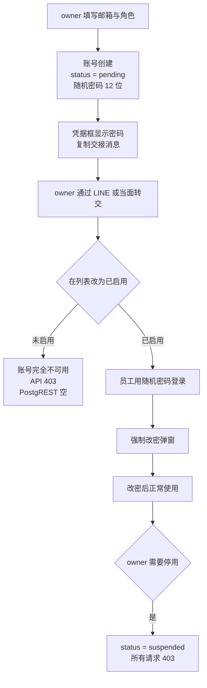

# Pomelo Shop — 账号状态与初始密码交接方案

## 1. 答案

**保留 pending 三态**（`pending` / `active` / `suspended`）。它是当前唯一可靠的隔离手段，且不需要任何新增代码：

| 检查点 | 对 pending 账号的行为 |
| --- | --- |
| [`requireRole()`](api/admin/_auth.js:99) | `profile.status !== "active"` → 403 |
| [`is_staff()`](supabase/migrations/0005_pomelo_security_hardening.sql:93) | `status = 'active'` 不成立 → PostgREST 返回空 |
| [`is_owner()`](supabase/migrations/0005_pomelo_security_hardening.sql:81) | 同上 |
| `change-password` | 走 `requireRole("user")` → 同样 403 |

pending 账号连改密码都做不到，在 API 和数据库两层都是彻底关闭的。这是**基础设施层拦截**，不是界面约定。

---

## 2. 三态方案唯一的缺口

owner 把账号改成 `active` 之后、员工首次登录之前，这段时间里：

- `status = active` → `requireRole` 放行
- 密码是共享的 `123456` → 知道邮箱的人可以直接登录
- `must_change_password` 只影响界面弹窗，不影响 API

**修法只有一个动作：初始密码改成每账号随机生成。**

---

## 3. 密码怎么交给员工

随机密码的交付是这套方案唯一的实操问题。设计原则：**这个密码是一次性的**——员工首次登录就会被强制改掉，所以它只需要满足"在交接那几分钟内不可猜"，不需要"长期高强度"。

因此长度取 **12 位、分 3 组、带连字符**：

```
Kf7m-Q2xR-9tLp
```

- 字符集排除 `0 O 1 l I`，共 57 个字符，12 位约 **70 bit 熵**——暴力破解不可行
- 分组后**可以念出来**：电话里说"K-F-7-M，杠，Q-2-X-R，杠，9-T-L-P"，员工能照抄
- 手机上输入不容易错位
- 20 位纯随机反而更难交接（念不清、抄错一位就登不上），安全性上没有实际收益

### 3.1 三种交付方式，按场景选

| 场景 | 做法 |
| --- | --- |
| owner 和员工当面 | 直接把屏幕转过来看，或念出来 |
| 远程（最常见） | 点「复制交接消息」，粘贴到 LINE / WhatsApp / 短信 |
| 员工把密码弄丢了 | owner 点「重置密码」生成新的，旧密码立刻失效，无需担心 |

### 3.2 「复制交接消息」按钮

凭据框里除了密码本身，提供一个按钮，一键把下面这段写进剪贴板：

```
Pomelo Shop 后台
网址：https://<当前域名>/login.html
账号：staff@example.com
初始密码：Kf7m-Q2xR-9tLp
首次登录会要求修改密码，请准备一个新密码（至少 8 位）。
```

域名用 `window.location.origin` 拼，本地调试和线上都正确。owner 粘贴即发送，避免手动抄错误。

### 3.3 界面要求

```
┌──────────────────────────────────────────────┐
│ 账号已创建，请立即转交。                      │
│                                              │
│ 邮箱      staff@example.com                  │
│ 初始密码  Kf7m-Q2xR-9tLp        [复制密码]   │
│                                              │
│ [复制交接消息]        [我已保存，关闭]        │
│                                              │
│ ⚠ 关闭后无法再次查看，只能重置密码。          │
└──────────────────────────────────────────────┘
```

- 密码用等宽字体，可选中
- 复制优先用 `navigator.clipboard.writeText`，失败时回退到 `document.execCommand("copy")`
- 关闭后明文从 DOM 移除，不留在 `state` 里

### 3.4 为什么不发邮件

Supabase 自带的邮件服务有严格限流，且本项目未配置自有 SMTP。要做"点一下就发邀请邮件"需要额外接 Resend/SendGrid 并维护域名解析，成本远高于"复制一段文字粘到 LINE"。作为后续可选项，不进入本次范围。

---

## 4. 代码改动

### 4.1 服务端 — [`api/admin/users.js`](api/admin/users.js:34)

删除固定常量：

```js
const DEFAULT_PASSWORD = "123456";   // 删除
```

替换为：

```js
import { randomInt } from "node:crypto";

// 排除易混字符 0/O/1/l/I，57 个字符
const ALPHABET = "ABCDEFGHJKLMNPQRSTUVWXYZabcdefghijkmnopqrstuvwxyz23456789";

// 12 位，按 4-4-4 分组，便于口头交接
function generatePassword() {
  let raw = "";
  for (let i = 0; i < 12; i++) raw += ALPHABET[randomInt(ALPHABET.length)];
  return raw.slice(0, 4) + "-" + raw.slice(4, 8) + "-" + raw.slice(8, 12);
}
```

- `createUser`：`const password = generatePassword();`，响应改为 `{ user, initialPassword: password }`
- 删除 `body.password` 自定义路径（[`users.js:71`](api/admin/users.js:71) 的 `explicitPassword`），少一条分支少一个洞
- `updateUser` 的 `resetPassword` 分支同样生成新密码，响应带上 `initialPassword`
- 明文不落库、不写日志

### 4.2 前端 — [`admin.html`](admin.html:291) / [`admin.js`](admin.js:1278)

- `admin.html` 在用户面板顶部加 `#credBox`（默认 `hidden`），结构与文案见 §3.3
- `admin.js` 的 `onCreateUser` 与 `onUserResetPassword` 拿到 `initialPassword` 后填充并显示
- 新增 `copyToClipboard(text)` 工具函数（含回退）
- 「复制交接消息」用 `window.location.origin` 拼 URL
- 「关闭」时清空 `#credBox` 的 `textContent`，并从 `state` 中移除密码

### 4.3 说明文案 — [`admin.html`](admin.html:287)

> 公开注册已关闭。员工账号只能由所有者在此创建，创建后为**待激活**。
> 初始密码由系统随机生成，只显示一次，请立即转交本人。
> 在下方列表把状态改为「已启用」后，员工即可登录，并被要求立即修改密码。

---

## 5. 明确不做的事

| 不做 | 理由 |
| --- | --- |
| 删除 `pending` 状态 | 它是当前唯一可靠的隔离手段；删掉要额外做 API + RLS 两层加固才能补回 |
| 数据库迁移 0007 | 三态方案不需要改 schema |
| `_auth.js` 的 `allowStalePassword` | pending 已经拦住了 |
| 4 个 RLS helper 改 | pending 已经拦住了 |
| `ban_duration` 封禁 | suspended 已在每个请求被 403 + RLS 拦截，收益低于成本 |
| `login.html` 改造 | 留作后续优化，不阻塞 |
| 邮件邀请 | 需要自建 SMTP，成本高于收益 |

---

## 6. 流程图



---

## 7. 验收测试

| # | 场景 | 期望 |
| --- | --- | --- |
| 1 | owner 创建账号 | `status = pending`，响应含形如 `Kf7m-Q2xR-9tLp` 的 `initialPassword` |
| 2 | 连续创建 10 个账号 | 密码各不相同，均符合 `4-4-4` 格式 |
| 3 | 用该密码调 `GET /api/admin/me` | `403`（pending 未激活） |
| 4 | 用该密码直连 `GET /rest/v1/pomelo_orders` | `[]` |
| 5 | 点「复制交接消息」 | 剪贴板含 URL、邮箱、密码、改密提示四行 |
| 6 | 关闭凭据框后重新查看 | 密码不再显示（只能重置） |
| 7 | owner 改为 `active` 后用该密码登录 | 成功，弹出改密框 |
| 8 | 改密后调 `/api/admin/orders` | `200` |
| 9 | owner 重置密码 | 返回新的随机密码，`must_change_password` 重新置 `true` |
| 10 | owner 改为 `suspended` | 该账号所有请求 403，PostgREST 返回 `[]` |
| 11 | owner 停用自己 | 被 `isSelf` 只读 + `assertNotLastOwner` 拦截 |
| 12 | 两个 owner，停用其中一个 | 允许 |

---

## 8. 待办

- [ ] [`api/admin/users.js`](api/admin/users.js:34) 删除 `DEFAULT_PASSWORD`，新增 `generatePassword()`（`crypto.randomInt`，12 位 4-4-4 分组）
- [ ] [`api/admin/users.js`](api/admin/users.js:66) `createUser` 返回 `{ user, initialPassword }`，删除 `explicitPassword` 分支
- [ ] [`api/admin/users.js`](api/admin/users.js:178) `resetPassword` 生成随机密码并返回
- [ ] [`admin.html`](admin.html:291) 新增 `#credBox` 凭据框、复制按钮、交接消息按钮，更新说明文案
- [ ] [`admin.js`](admin.js:1278) `onCreateUser` 与 [`onUserResetPassword`](admin.js:1251) 展示凭据框
- [ ] [`admin.js`](admin.js:1278) 新增 `copyToClipboard()`（含 `execCommand` 回退）与交接消息拼装
- [ ] 跑 §7 的 12 项测试
- [ ] 更新 [`plans/BACKLOG.md`](plans/BACKLOG.md:100)：FEAT-05 标记为已解决
