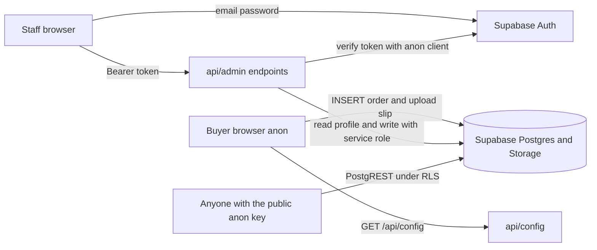

# Pomelo Shop — User-Tier Architecture & Permission Audit

Status: **P0/P1 implemented — see [`plans/BACKLOG.md`](BACKLOG.md) for remaining work**
Scope: buyer/anon boundary, staff roles (`user` / `admin` / `owner`), Supabase RLS, `/api/admin/*`, admin console.
Method: static review of migrations, API handlers and client code. No runtime penetration test was performed.

> **Outstanding items are tracked in [`plans/BACKLOG.md`](BACKLOG.md).** That file is the single source of
> truth for all open work. The todo list in section 6 below is the original remediation plan and is kept
> for historical context; check the backlog for current status.

---

## 1. Verdict

The three-tier model is consistently **described** and mostly consistently **enforced in the API**, but the
database trust boundary is broken in several places. The current build is **not production-safe** for
customer PII until the critical items below are fixed.

Highest-risk outcomes:

1. Any authenticated account can promote itself to `owner` directly through PostgREST.
2. Public sign-up, plus a fail-open role lookup, gives arbitrary accounts staff access to every order.
3. Anyone holding the public anon key can read the owner's bank details.
4. A `user` can bypass the order-field whitelist and change amounts directly through PostgREST.
5. A buyer-controlled `slip_url` is rendered as a clickable link in the admin console, enabling session theft.

---

## 2. As-built architecture



Trust boundaries that exist today:

- The admin console never asserts its own role; [`api/admin/_auth.js`](../api/admin/_auth.js:68) re-checks it.
- `service_role` is server-only and used by the admin API.
- The buyer has no account and only inserts orders/uploads slips.

Trust boundaries that are currently missing:

- PostgREST is a **second, less-guarded write path** for authenticated staff.
- Authentication alone is treated as staff membership.
- Public reads are broader than the storefront actually needs.

---

## 3. As-built role and endpoint matrix

| Surface | Method | Required role in code | Notes |
| --- | --- | --- | --- |
| `/api/admin/me` | GET | `user` | Missing profile is treated as `user` — fail-open |
| `/api/admin/orders` | GET | `user` | All orders, all customer PII |
| `/api/admin/orders` | PATCH | `user` | API allows only `status`, `note` |
| `/api/admin/orders` | PATCH | `admin` / `owner` | API allows `status`, `note`, `fulfilment`, `slip_url`, `total_satang`, `items` |
| `/api/admin/orders-export` | GET | `user` | All orders, all customer PII |
| `/api/admin/catalogue` | GET | `user` | Harmless because catalogue is public |
| `/api/admin/catalogue` | POST/PATCH/DELETE | `admin` | SKU generated server-side |
| `/api/admin/delivery-methods` | GET | `user` | Needed for order labels |
| `/api/admin/delivery-methods` | POST/PATCH/DELETE | `admin` | Code generated server-side |
| `/api/admin/content` | GET | `user` | Content is public anyway |
| `/api/admin/content` | PUT | `owner` | |
| `/api/admin/settings` | GET | `user` | Returns **all** settings, including bank details |
| `/api/admin/settings` | PUT | `owner` | |
| `/api/admin/users` | GET/PATCH | `owner` | Cannot change own role; no create/suspend/delete |
| `/api/admin/payment-qr` | POST | `admin` | Decode only |
| `/api/admin/payment-qr` | PUT/DELETE | `owner` | Confirm/clear active payload |

---

## 4. Findings by severity

### P0-1 — Any authenticated user can promote themselves to `owner`

Evidence: [`0002_pomelo_rbac.sql`](../supabase/migrations/0002_pomelo_rbac.sql:154)

```sql
create policy "profiles_update_own"
  on public.profiles for update
  to authenticated
  using (auth.uid() = id)
  with check (auth.uid() = id);
```

RLS is row-level, not column-level. With Supabase's standard grants on `public` tables, a signed-in
`user` can send:

```http
PATCH /rest/v1/profiles?id=eq.<own-id>
{ "role": "owner" }
```

using the public anon key plus their own JWT. The policy allows the row update and the `with check`
only verifies row ownership. This is a direct privilege escalation to full ownership.

**Fix:** never allow a non-owner to change `role` or `status`. Prefer removing self-update entirely;
if profile self-editing is wanted, restrict it to `full_name` and add a database trigger that rejects
role/status changes unless the caller is an active owner. Also prevent an owner from demoting the last
active owner.

---

### P0-2 — Public sign-up plus fail-open role resolution grants staff access

Evidence:

- Trigger creates a profile with `role = 'user'` for every new auth user: [`0002_pomelo_rbac.sql`](../supabase/migrations/0002_pomelo_rbac.sql:113)
- Missing profile is treated as `user`: [`_auth.js`](../api/admin/_auth.js:91)
- README still instructs signing up through `/login.html`: [`README.md`](../README.md:86) even though that page has no sign-up form
- Any auth user can call `/api/admin/orders` as `user`: [`orders.js`](../api/admin/orders.js:32)

Supabase email/password sign-up is enabled by default. A person who can reach the public anon key
from [`api/config.js`](../api/config.js:48) can create an account, receive a `user` profile, sign in,
and then read every order, phone number, slip link, and the settings endpoint. The same is true for
any auth user whose profile row is missing.

**Fix:**

1. Disable public sign-ups in Supabase Auth.
2. Fail closed in `_auth.js`: no profile, unknown role, or non-active status means `403`.
3. Add an account lifecycle state (`pending` / `active` / `suspended`) and default new profiles to
   `pending`; only an owner may activate.
4. Add owner-only user provisioning instead of relying on dashboard/direct sign-up.

---

### P0-3 — Public read of `pomelo_settings` exposes bank details to anyone

Evidence: [`0002_pomelo_rbac.sql`](../supabase/migrations/0002_pomelo_rbac.sql:185)

```sql
create policy "settings_public_read"
  on public.pomelo_settings for select
  to anon, authenticated
  using (true);
```

The storefront only needs `promptpay_id` and `promptpay_qr_payload`. The same table also contains
`bank_name`, `bank_account`, and `bank_holder`. Anyone with the public anon key can read all of them.

**Fix:** split visibility by key and role:

- `anon`: only `promptpay_id`, `promptpay_qr_payload`
- `authenticated` staff: all settings (or `admin+` only, see open decisions)
- `owner`: write

`/api/config` can keep using the anon key because RLS will filter the rows.

---

### P1-1 — A `user` can bypass the order PATCH whitelist through PostgREST

Evidence: [`0002_pomelo_rbac.sql`](../supabase/migrations/0002_pomelo_rbac.sql:285)

```sql
create policy "orders_staff_update"
  on public.pomelo_orders for update
  to authenticated
  using (public.is_staff())
  with check (public.is_staff());
```

The API restricts a `user` to `status` and `note` in [`orders.js`](../api/admin/orders.js:18), but RLS
does not. A `user` can call PostgREST directly and change `total_satang`, `items`, `slip_url`, or
`fulfilment`. This defeats the documented defence-in-depth claim.

**Fix:** remove the direct UPDATE policy and revoke `UPDATE` on `pomelo_orders` from `authenticated`.
All order mutations go through `/api/admin/orders` with `service_role`. Keep staff SELECT for
read-only defence in depth.

---

### P1-2 — No active/suspended state and no offboarding path

Evidence: role is the only account attribute and its check constraint allows only `user`, `admin`,
`owner`: [`0002_pomelo_rbac.sql`](../supabase/migrations/0002_pomelo_rbac.sql:40). `users.js` can only
change role: [`users.js`](../api/admin/users.js:35).

There is no way to disable a departed employee without deleting their auth account in the Supabase
dashboard. There is also no owner UI to create accounts.

**Fix:** add `status` (`pending`, `active`, `suspended`), require `active` in every role helper and in
`_auth.js`, and extend the owner-only users API to activate, suspend, and provision accounts.

---

### P1-3 — Buyer-controlled `slip_url` can become a stored XSS/session-theft link

Evidence:

- Anon INSERT accepts any `slip_url`: [`0001_pomelo_orders.sql`](../supabase/migrations/0001_pomelo_orders.sql:73)
- Buyer submits a client-built URL: [`app.js`](../app.js:611)
- Admin console renders it as an anchor: [`admin.js`](../admin.js:253)

`escapeHtml` prevents breaking out of the attribute, but it does not block a `javascript:` URL. A
malicious buyer can insert `slip_url: "javascript:..."` directly through PostgREST. When staff clicks
"查看转账凭证", script runs in the admin origin, where the Supabase session is stored in
`localStorage`.

**Fix:**

1. Add a `BEFORE INSERT` trigger on `pomelo_orders` that rejects any `slip_url` not starting with
   `https://` and forces `status = 'pending'` and `created_at = now()`.
2. In `admin.js`, only render the link when the URL parses as `http:` or `https:`.
3. Consider a CSP so inline script execution is not possible even if a bad URL slips through.

---

### P1-4 — Transfer slips are enumerable by anon

Evidence: the bucket is public and the select policy allows the whole bucket:
[`0001_pomelo_orders.sql`](../supabase/migrations/0001_pomelo_orders.sql:108)

Anyone with the anon key can list `pomelo-slips`, exposing every uploaded bank slip. The UUID folder
names are hard to guess, but the list policy removes that protection.

**Fix:** remove the anon SELECT/list policy. Keep direct public object URLs if staff need simple
links, or move to a private bucket with short-lived signed URLs generated by the admin API.

---

### P2-1 — `user` can read bank settings despite the stated role definition

The stated `user` role is order viewing and fulfilment only. The settings tab is visible to `user`
because of `data-min="user"` in [`admin.html`](../admin.html:142), and `/api/admin/settings` GET
requires only `user` in [`settings.js`](../api/admin/settings.js:37).

**Fix:** make the settings tab and settings GET `admin+`, or return only `promptpay_*` keys to a
`user`. Do not expose bank fields to fulfilment staff.

---

### P2-2 — Direct RLS writes on catalogue/delivery/content bypass API validation

The API enforces SKU generation, delivery-code generation, price integer checks, URL scheme checks,
and length limits. The RLS write policies allow direct table writes that skip all of it:

- [`0002_pomelo_rbac.sql`](../supabase/migrations/0002_pomelo_rbac.sql:228)
- [`0004_pomelo_delivery_methods.sql`](../supabase/migrations/0004_pomelo_delivery_methods.sql:67)
- [`0002_pomelo_rbac.sql`](../supabase/migrations/0002_pomelo_rbac.sql:262)

This is not privilege escalation for a trusted `admin`, but it weakens invariants and makes behaviour
depend on which write path was used.

**Fix:** choose one write path. Recommended: authenticated staff writes go only through
`/api/admin/*` with `service_role`; RLS gives staff read access only. Add database constraints for
critical invariants if direct writes must remain.

---

### P2-3 — `promptpay_qr_payload` can be written through the generic settings endpoint

Evidence: the key is in `WRITABLE_KEYS` in [`settings.js`](../api/admin/settings.js:16), so an owner
can bypass the EMVCo CRC validation in [`payment-qr.js`](../api/admin/payment-qr.js:229).

**Fix:** reject `promptpay_qr_payload` in the generic settings PUT, or validate it with the same
EMVCo parser before saving.

---

### P2-4 — Admin token snapshot is never refreshed

Evidence: `state.session` is captured once at boot in [`admin.js`](../admin.js:1255) and the bearer
token is read from it on every call in [`admin.js`](../admin.js:113). There is no
`onAuthStateChange` listener.

After the access token expires, the console starts sending a stale token and the API returns `401`,
forcing a re-login. This is a reliability issue, not an authorization bypass.

**Fix:** read the current session inside the API wrapper, or subscribe to `onAuthStateChange` and
update `state.session`.

---

### P2-5 — Order totals are fully client-supplied

The buyer inserts `total_satang` and `items` directly, and no server recomputes them. A modified
client can record a low total after paying a low QR amount.

**Fix:** create orders through a server endpoint that recomputes the total from `pomelo_catalogue`
and returns the authoritative amount before the QR is shown. At minimum, document the risk and add
server-side validation for `items` and total consistency.

---

### P3 — Hardening and hygiene

- No CSP, HSTS, or frame protection in [`vercel.json`](../vercel.json:5).
- CDN scripts are loaded without SRI in [`login.html`](../login.html:101).
- No audit log for role changes, settings writes, or order edits.
- Documentation drift: README says sign-up happens through `/login.html`; there is no sign-up form.
  [`api/config.js`](../api/config.js:25) says the service-role key must never be added to the
  environment, but the admin API requires it.
- `items` and `total_satang` are not cross-validated in [`orders.js`](../api/admin/orders.js:84).

---

## 5. Target model

### Roles and states

| Role | State | Capabilities |
| --- | --- | --- |
| `owner` | `active` | Everything, including staff lifecycle and sensitive settings |
| `admin` | `active` | Orders, catalogue, delivery methods, read settings; no role management, no content/settings writes |
| `user` | `active` | Orders read, status/note update, delivery read; no bank settings |
| — | `pending` | Account created but not yet activated; no API access |
| — | `suspended` | Access revoked without deleting the auth account; no API access |

### Write-path principle

- Buyer anon: INSERT-only into orders and upload-only into storage.
- Authenticated staff: **read-only** through PostgREST/RLS.
- All staff mutations: `/api/admin/*` with `service_role`, after server-side role and status checks.
- `service_role` remains server-only.

### Target policy matrix

| Table | anon | authenticated staff | owner write | service role |
| --- | --- | --- | --- | --- |
| `profiles` | none | own row read | role/status via API | full |
| `pomelo_settings` | payment keys only | all rows read | via API | full |
| `pomelo_catalogue` | read | read | via API | full |
| `pomelo_page_content` | read | read | via API | full |
| `pomelo_delivery_methods` | read | read | via API | full |
| `pomelo_orders` | INSERT only | read | via API | full |
| `storage.pomelo-slips` | INSERT only | owner/admin read | via API | full |

---

## 6. Remediation todo list

### Phase 0 — Preflight and containment

- [ ] Confirm the project is the dedicated Supabase project, not the shared open-play project.
- [ ] Run a policy/grant inventory: `pg_policies`, `information_schema.role_table_grants`, and `has_table_privilege`.
- [ ] Disable public sign-ups in Supabase Auth until owner-only provisioning exists.
- [ ] Rotate the anon/service-role keys if there is any doubt they were exposed.

### Phase 1 — Critical database migration

Create `supabase/migrations/0005_pomelo_security_hardening.sql`:

- [ ] Add `profiles.status text not null default 'pending' check (status in ('pending','active','suspended'))`.
- [ ] Backfill existing intended staff to `active`; keep any unknown accounts `pending`.
- [ ] Update `handle_new_user()` to insert `status = 'pending'`.
- [ ] Update `is_owner()`, `is_staff()`, and `is_admin_or_owner()` to require `status = 'active'`.
- [ ] Remove `profiles_update_own`, or add a trigger that rejects non-owner changes to `role` and `status`.
- [ ] Add a last-owner guard: reject demoting or suspending the final active owner.
- [ ] Replace `settings_public_read` with anon payment-key-only read plus staff read.
- [ ] Drop `orders_staff_update`; revoke `UPDATE` on `pomelo_orders` from `authenticated`.
- [ ] Add an orders `BEFORE INSERT` trigger: force `status = 'pending'`, force `created_at = now()`, reject non-`https` `slip_url`.
- [ ] Drop the anon storage SELECT policy; replace with authenticated staff read if listing is needed.
- [ ] Add verification queries at the end of the migration.

### Phase 2 — API and admin console

- [ ] `_auth.js`: fail closed when the profile is missing, role is unknown, or status is not `active`.
- [ ] `settings.js`: require `admin+` for GET, or filter bank keys for `user`.
- [ ] `admin.html`: change the settings tab to `data-min="admin"`.
- [ ] `admin.js`: only render `slip_url` when it parses as `http:` or `https:`.
- [ ] `admin.js`: refresh `state.session` via `onAuthStateChange` or `getSession()` per request.
- [ ] `users.js`: support `status` changes and owner-only account provisioning; keep the self-demotion guard.
- [ ] `orders.js`: validate `items` shape and total consistency for admin/owner edits.
- [ ] `payment-qr.js`/`settings.js`: prevent unvalidated `promptpay_qr_payload` writes.
- [ ] Add a server-side order-creation endpoint if price integrity is in scope.

### Phase 3 — Operations, tests, documentation

- [ ] Add `pomelo_audit` for role, status, settings, and order mutations.
- [ ] Add CSP, `frame-ancestors`, and SRI for CDN scripts.
- [ ] Update [`README.md`](../README.md:86) and [`plans/rbac-design.md`](rbac-design.md) to match the final model.
- [ ] Add a role test checklist: anon, pending, user, admin, owner, suspended.
- [ ] Add explicit negative tests for direct PostgREST escalation attempts.

---

## 7. Acceptance criteria

- A `user` cannot change their own `role` or `status` through PostgREST or the API.
- An auth account without an active profile receives `403` from every `/api/admin/*` endpoint.
- Public sign-up is disabled, or new sign-ups remain `pending` with zero data access.
- Anon cannot read `bank_name`, `bank_account`, or `bank_holder`.
- A `user` cannot change order amounts, items, or slip URLs through any path.
- A buyer cannot insert a `javascript:` or `data:` slip URL.
- Anon cannot list the slip bucket.
- An owner can activate, suspend, and provision staff without using the Supabase dashboard.
- The last active owner cannot be demoted or suspended.

---

## 8. Open decisions

1. Should `user` see any settings at all? Recommendation: no; settings tab and API become `admin+`.
2. Should transfer slips move to a private bucket with signed URLs? Recommendation: yes, because slips contain PII.
3. Should order creation move server-side to enforce pricing? Recommendation: yes, because the current total is buyer-controlled.
4. Keep direct RLS write policies for trusted admins, or make `/api/admin/*` the only write path? Recommendation: one write path, API-only.
